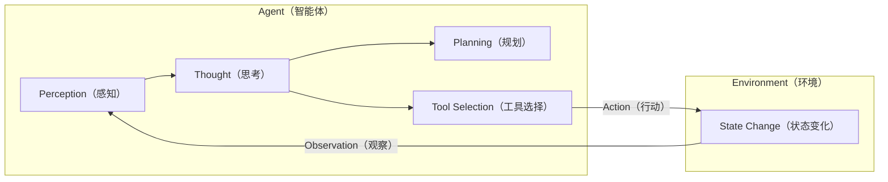
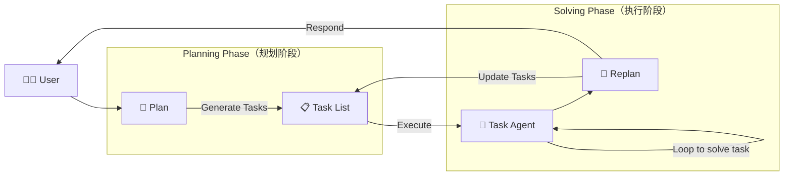

## 第一章 初识智能体

### 1.1 什么是智能体？

**智能体（Agent）** 是能够通过**传感器（Sensors）**感知环境（Environment），并自主决策，通过**执行器（Actuators）**采取行动（Action）以实现特定目标的实体。

其核心工作流程为：**感知 → 决策 → 行动 → 反馈**。

#### 1.1.2 大语言模型驱动的新范式

传统智能体主要依赖工程师设计的规则、模型与知识体系；**LLM 智能体**则利用大语言模型预训练获得的知识和推理能力，更灵活地理解任务、制定计划并调用工具。

其核心能力包括：

1. **规划与推理（Planning & Reasoning）**：理解复杂目标并分解为可执行的子任务。
2. **工具使用（Tool Use）**：调用搜索、API、数据库等外部工具获取信息或执行操作。
3. **动态修正（Dynamic Adaptation）**：根据环境变化、工具反馈和用户要求调整计划。

**示例：规划厦门旅行**

- **规划**：确认需求 → 查询信息 → 制定行程 → 预订服务。
- **工具调用**：查询实时天气、交通、酒店等信息。
- **动态调整**：根据天气变化调整景点，根据预算反馈重新筛选酒店。

LLM 智能体的关键在于：**将语言模型的理解与推理能力，同外部工具和环境反馈结合，实现动态任务执行。**

### 1.2 智能体的构成与运行原理

#### 1.2.2 智能体的运行机制

智能体通过持续的**智能体循环（Agent Loop）**与环境交互，而非一次性完成任务。



#### 1.2.3 智能体的感知与行动

LLM 智能体通过**交互协议（Interaction Protocol）**规范与环境的信息交换，其输出通常采用结构化格式，包含两个核心部分：

1. **Thought（思考）**：分析当前情境与观察结果，进行反思、问题分解和下一步行动规划。
2. **Action（行动）**：根据思考结果执行具体操作，通常表现为函数调用。

**示例：查询北京天气**

```text
Thought: 用户想知道北京的天气。我需要调用天气查询工具。
Action: get_weather("北京")
```

外部**解析器（Parser）**识别 Action 指令，并调用对应的 `get_weather` 函数。

执行后，环境返回原始数据（如 JSON）。感知系统将其处理为简洁的自然语言文本，即 **Observation（观察）**：

```text
Observation: 北京当前天气为晴，气温25摄氏度，微风。
```

**Observation** 将作为下一轮循环的输入，供智能体继续进行 Thought 和 Action。

### 1.3 动手体验：5 分钟实现第一个智能体

**目标**：构建一个能够处理分步任务的智能旅行助手。

**用户任务**：“你好，请帮我查询一下今天北京的天气，然后根据天气推荐一个合适的旅游景点。”

智能体需要先调用天气查询工具，再根据返回的观察结果调用景点推荐工具，最终生成建议，体现其**任务规划与多轮工具调用能力**。

#### 1.3.1 准备工作

安装以下 Python 库：

- **requests**：发送 HTTP 请求，访问网络 API。
- **tavily-python**：调用 Tavily 搜索 API，获取实时网络信息（需注册获取 API Key）。
- **openai**：OpenAI 官方 SDK，用于调用 GPT 等大语言模型。

```text
pip install requests tavily-python openai
```

**（1）指令模板**

通过**提示工程（Prompt Engineering）**定义智能体的角色、可用工具及 Thought-Action 输出格式，并将其作为 `system_prompt` 传递给 LLM。

```python
AGENT_SYSTEM_PROMPT = """
你是一个智能旅行助手。你的任务是分析用户的请求，并使用可用工具一步步地解决问题。

# 可用工具:
- `get_weather(city: str)`: 查询指定城市的实时天气。
- `get_attraction(city: str, weather: str)`: 根据城市和天气搜索推荐的旅游景点。

# 输出格式要求:
你的每次回复必须严格遵循以下格式，包含一对Thought和Action：

Thought: [你的思考过程和下一步计划]
Action: [你要执行的具体行动]

Action的格式必须是以下之一：
1. 调用工具：function_name(arg_name="arg_value")
2. 结束任务：Finish[最终答案]

# 重要提示:
- 每次只输出一对Thought-Action
- Action必须在同一行，不要换行
- 当收集到足够信息可以回答用户问题时，必须使用 Action: Finish[最终答案] 格式结束

请开始吧！
"""
```

**（2）工具 1：查询真实天气**

使用免费的 **wttr.in API** 获取指定城市的实时天气，并将 JSON 数据转换为自然语言。

```python
import requests

def get_weather(city: str) -> str:
    """
    通过调用 wttr.in API 查询真实的天气信息。
    """
    # API端点，我们请求JSON格式的数据
    url = f"https://wttr.in/{city}?format=j1"

    try:
        # 发起网络请求
        response = requests.get(url)
        # 检查响应状态码是否为200 (成功)
        response.raise_for_status()&#x20;
        # 解析返回的JSON数据
        data = response.json()

        # 提取当前天气状况
        current_condition = data['current_condition'][0]
        weather_desc = current_condition['weatherDesc'][0]['value']
        temp_c = current_condition['temp_C']

        # 格式化成自然语言返回
        return f"{city}当前天气:{weather_desc}，气温{temp_c}摄氏度"

    except requests.exceptions.RequestException as e:
        # 处理网络错误
        return f"错误:查询天气时遇到网络问题 - {e}"
    except (KeyError, IndexError) as e:
        # 处理数据解析错误
        return f"错误:解析天气数据失败，可能是城市名称无效 - {e}"
```

**（3）工具 2：搜索并推荐旅游景点**

定义 `get_attraction`，根据城市和天气调用 **Tavily Search API**，获取景点推荐。优先返回综合回答，否则整理原始搜索结果。

```python
import os
from tavily import TavilyClient

def get_attraction(city: str, weather: str) -> str:
    """
    根据城市和天气，使用Tavily Search API搜索并返回优化后的景点推荐。
    """
    # 1. 从环境变量中读取API密钥
    api_key = os.environ.get("TAVILY_API_KEY")
    if not api_key:
        return "错误:未配置TAVILY_API_KEY环境变量。"

    # 2. 初始化Tavily客户端
    tavily = TavilyClient(api_key=api_key)

    # 3. 构造一个精确的查询
    query = f"'{city}' 在'{weather}'天气下最值得去的旅游景点推荐及理由"

    try:
        # 4. 调用API，include_answer=True会返回一个综合性的回答
        response = tavily.search(query=query, search_depth="basic", include_answer=True)

        # 5. Tavily返回的结果已经非常干净，可以直接使用
        # response['answer'] 是一个基于所有搜索结果的总结性回答
        if response.get("answer"):
            return response["answer"]

        # 如果没有综合性回答，则格式化原始结果
        formatted_results = []
        for result in response.get("results", []):
            formatted_results.append(f"- {result['title']}: {result['content']}")

        if not formatted_results:
             return "抱歉，没有找到相关的旅游景点推荐。"

        return "根据搜索，为您找到以下信息:\n" + "\n".join(formatted_results)

    except Exception as e:
        return f"错误:执行Tavily搜索时出现问题 - {e}"
```

最后，将工具函数注册到字典 `available_tools`，供智能体主循环调用。

```python
# 将所有工具函数放入一个字典，方便后续调用
available_tools = {
    "get_weather": get_weather,
    "get_attraction": get_attraction,
}
```

#### 1.3.2 接入大语言模型

实现通用客户端 `OpenAICompatibleClient`，用于连接兼容 OpenAI 接口规范的 LLM 服务。

```python
from openai import OpenAI

class OpenAICompatibleClient:
    """
    一个用于调用任何兼容OpenAI接口的LLM服务的客户端。
    """
    def __init__(self, model: str, api_key: str, base_url: str):
        self.model = model
        self.client = OpenAI(api_key=api_key, base_url=base_url)

    def generate(self, prompt: str, system_prompt: str) -> str:
        """调用LLM API来生成回应。"""
        print("正在调用大语言模型...")
        try:
            messages = [
                {'role': 'system', 'content': system_prompt},
                {'role': 'user', 'content': prompt}
            ]
            response = self.client.chat.completions.create(
                model=self.model,
                messages=messages,
                stream=False
            )
            answer = response.choices[0].message.content
            print("大语言模型响应成功。")
            return answer
        except Exception as e:
            print(f"调用LLM API时发生错误: {e}")
            return "错误:调用语言模型服务时出错。"
```

#### 1.3.3 执行行动循环

主循环整合各组件，通过格式化的 Prompt 驱动 LLM 进行决策。

```python
import re
import os
from dotenv import load_dotenv

from agent_config import OpenAICompatibleClient
from agent_config import AGENT_SYSTEM_PROMPT
from tools import available_tools

# --- 1. 配置LLM客户端 ---
# 从 .env 加载环境变量
load_dotenv()

API_KEY = os.getenv("OPENAI_API_KEY")
MODEL_ID = os.getenv("OPENAI_MODEL_ID")
TAVILY_API_KEY = os.getenv("TAVILY_API_KEY")
BASE_URL = os.getenv("OPENAI_BASE_URL")

# 简单校验，避免配置缺失导致难排查的错误
if not all([API_KEY, MODEL_ID, TAVILY_API_KEY, BASE_URL]):
    raise ValueError("请检查 .env 文件，OPENAI_API_KEY / OPENAI_MODEL_ID / TAVILY_API_KEY / OPENAI_BASE_URL 不能为空")

llm = OpenAICompatibleClient(
    model=MODEL_ID,
    api_key=API_KEY,
    base_url=BASE_URL
)

# --- 2. 初始化 ---
user_prompt = "你好，请帮我查询一下今天北京的天气，然后根据天气推荐一个合适的旅游景点。"
prompt_history = [f"用户请求: {user_prompt}"]

print(f"用户输入: {user_prompt}\n" + "="*40)

# --- 3. 运行主循环 ---
for i in range(5): # 设置最大循环次数
    print(f"--- 循环 {i+1} ---\n")
    
    # 3.1. 构建Prompt
    full_prompt = "\n".join(prompt_history)
    
    # 3.2. 调用LLM进行思考
    llm_output = llm.generate(full_prompt, system_prompt=AGENT_SYSTEM_PROMPT)
    # 模型可能会输出多余的Thought-Action，需要截断
    match = re.search(r'(Thought:.*?Action:.*?)(?=\n\s*(?:Thought:|Action:|Observation:)|\Z)', llm_output, re.DOTALL)
    if match:
        truncated = match.group(1).strip()
        if truncated != llm_output.strip():
            llm_output = truncated
            print("已截断多余的 Thought-Action 对")
    print(f"模型输出:\n{llm_output}\n")
    prompt_history.append(llm_output)
    
    # 3.3. 解析并执行行动
    action_match = re.search(r"Action: (.*)", llm_output, re.DOTALL)
    if not action_match:
        observation = "错误: 未能解析到 Action 字段。请确保你的回复严格遵循 'Thought: ... Action: ...' 的格式。"
        observation_str = f"Observation: {observation}"
        print(f"{observation_str}\n" + "="*40)
        prompt_history.append(observation_str)
        continue
    action_str = action_match.group(1).strip()

    if action_str.startswith("Finish"):
        final_answer = re.match(r"Finish\[(.*)\]", action_str).group(1)
        print(f"任务完成，最终答案: {final_answer}")
        break
    
    tool_name = re.search(r"(\w+)\(", action_str).group(1)
    args_str = re.search(r"\((.*)\)", action_str).group(1)
    kwargs = dict(re.findall(r'(\w+)="([^"]*)"', args_str))

    if tool_name in available_tools:
        observation = available_tools[tool_name](**kwargs)
    else:
        observation = f"错误:未定义的工具 '{tool_name}'"

    # 3.4. 记录观察结果
    observation_str = f"Observation: {observation}"
    print(f"{observation_str}\n" + "="*40)
    prompt_history.append(observation_str)
```

#### 1.3.4 运行案例分析

以下通过三轮执行循环，展示智能体解决任务的完整流程。

```text
用户输入: 你好，请帮我查询一下今天北京的天气，然后根据天气推荐一个合适的旅游景点。
========================================
--- 循环 1 ---

正在调用大语言模型...
大语言模型响应成功。
模型输出:
Thought: 首先需要获取北京今天的天气情况，之后再根据天气情况来推荐旅游景点。
Action: get_weather(city="北京")

Observation: 北京当前天气:Sunny，气温26摄氏度
========================================      
--- 循环 2 ---

正在调用大语言模型...
大语言模型响应成功。
模型输出:
Thought: 现在已经知道了北京今天的天气是晴朗且温度适中，接下来可以基于这个信息来推荐一个适合的旅游景点了。
Action: get_attraction(city="北京", weather="Sunny")

Observation: 北京在晴天最值得去的旅游景点是颐和园，因其美丽的湖景和古建筑。另一个推荐是长城，因其壮观的景观和历史意义。
========================================
--- 循环 3 ---

正在调用大语言模型...
大语言模型响应成功。
模型输出:
Thought: 已经获得了两个适合晴天游览的景点建议，现在可以根据这些信息给用户提供满意的答复。
Action: Finish[今天北京的天气是晴朗的，气温26摄氏度，非常适合外出游玩。我推荐您去颐和园欣赏美丽的湖景和古建筑，或者前往长城体验其壮观的景观和深厚的历史意义。希望您有一个愉快的旅行！]

任务完成，最终答案: 今天北京的天气是晴朗的，气温26摄氏度，非常适合外出游玩。我推荐您去颐和园欣赏美丽的湖景和古建筑，或者前往长城体验其壮观的景观和深厚的历史意义。希望您有一个愉快的旅行！
```

该案例通过 **Thought-Action-Observation** 范式，展示了智能体的四项基本能力：**任务分解、工具调用、上下文理解和结果合成**。

### 1.4 智能体应用的协作模式

根据智能体的角色与自主性，其协作模式主要分为两类：

- **开发者工具**：融入工作流，辅助人类完成任务。
- **自主协作者**：接受高层级目标，自主规划并协作完成复杂任务。

#### 1.4.3 Workflow 和 Agent 的差异

**核心区别：Workflow 按预设流程执行任务，Agent 自主规划行动以达成目标。**

**（1）Workflow（工作流）**

工作流是一种传统自动化范式，通过**预先定义的步骤、执行顺序和判断条件**完成任务，流程具有结构化、确定性的特点。

**示例：企业费用报销审批**

- 员工提交报销单，触发审批流程。
- 金额小于 500 元：由部门经理审批。
- 金额大于 500 元：先由部门经理审批，再由财务总监审批。
- 审批通过后，通知财务部打款。

所有步骤与判断条件均由开发者预先设定。

**（2）Agent（智能体）**

Agent 是**具备自主性、以目标为导向**的系统，由 LLM 充当决策核心，根据环境信息动态推理、规划和执行任务。

**示例：智能旅行助手**

用户请求：“查询今天北京的天气，并推荐合适的旅游景点。”

1. **规划与工具调用**：将任务拆解为查询天气和推荐景点，自主调用天气 API。
2. **推理与决策**：根据天气结果筛选景点。例如，晴天推荐颐和园、故宫等户外景点；雨天推荐博物馆等室内场所。
3. **生成结果**：整合天气与景点信息，形成最终推荐。

整个过程无需预设 `if 天气=晴天 then 推荐颐和园` 等固定规则，而是根据实时信息动态决策。

## 第三章 大语言模型基础

### 3.1 语言模型与 Transformer 架构

#### 3.1.2 Transformer 架构解析

RNN 和 LSTM 通过循环结构处理序列，但必须按时间步顺序计算，难以并行化，限制了长序列处理效率和模型规模。

**Transformer**，完全摒弃循环结构，采用**注意力机制（Attention）**捕捉序列依赖关系，实现并行计算。

**（1）Encoder-Decoder 整体结构**

最初的 Transformer 面向机器翻译任务，采用**编码器-解码器（Encoder-Decoder）**架构。


- **编码器（Encoder）**：读取所有输入词元，为每个词元生成包含上下文信息的向量表示。
- **解码器（Decoder）**：结合已生成的前文和编码器的输出，逐步预测并生成下一个词元。

```python
import torch
import torch.nn as nn
import math
# --- 占位符模块，将在后续小节中实现 ---
class PositionalEncoding(nn.Module):
    """
    位置编码模块
    """
    def forward(self, x):
        pass
class MultiHeadAttention(nn.Module):
    """
    多头注意力机制模块
    """
    def forward(self, query, key, value, mask):
        pass
class PositionWiseFeedForward(nn.Module):
    """
    位置前馈网络模块
    """
    def forward(self, x):
        pass
# --- 编码器核心层 ---
class EncoderLayer(nn.Module):
    def __init__(self, d_model, num_heads, d_ff, dropout):
        super(EncoderLayer, self).__init__()
        self.self_attn = MultiHeadAttention() # 待实现
        self.feed_forward = PositionWiseFeedForward() # 待实现
        self.norm1 = nn.LayerNorm(d_model)
        self.norm2 = nn.LayerNorm(d_model)
        self.dropout = nn.Dropout(dropout)
    def forward(self, x, mask):
        # 残差连接与层归一化将在 3.1.2.4 节中详细解释
        # 1. 多头自注意力
        attn_output = self.self_attn(x, x, x, mask)
        x = self.norm1(x + self.dropout(attn_output))
        # 2. 前馈网络
        ff_output = self.feed_forward(x)
        x = self.norm2(x + self.dropout(ff_output))
        return x
# --- 解码器核心层 ---
class DecoderLayer(nn.Module):
    def __init__(self, d_model, num_heads, d_ff, dropout):
        super(DecoderLayer, self).__init__()
        self.self_attn = MultiHeadAttention() # 待实现
        self.cross_attn = MultiHeadAttention() # 待实现
        self.feed_forward = PositionWiseFeedForward() # 待实现
        self.norm1 = nn.LayerNorm(d_model)
        self.norm2 = nn.LayerNorm(d_model)
        self.norm3 = nn.LayerNorm(d_model)
        self.dropout = nn.Dropout(dropout)
    def forward(self, x, encoder_output, src_mask, tgt_mask):
        # 1. 掩码多头自注意力 (对自己)
        attn_output = self.self_attn(x, x, x, tgt_mask)
        x = self.norm1(x + self.dropout(attn_output))
        # 2. 交叉注意力 (对编码器输出)
        cross_attn_output = self.cross_attn(x, encoder_output, encoder_output, src_mask)
        x = self.norm2(x + self.dropout(cross_attn_output))
        # 3. 前馈网络
        ff_output = self.feed_forward(x)
        x = self.norm3(x + self.dropout(ff_output))
        return x
```

**（2）从自注意力到多头注意力**

**自注意力机制（Self-Attention）**允许模型在处理每个词元时，关注序列中的其他词元，并根据关联程度分配不同的注意力权重。

例如，在句子 `The agent learns because it is intelligent.` 中，模型可以通过自注意力识别 `it` 与 `agent` 的指代关系。

**自注意力的三个核心向量：**

- **查询（Query，Q）**：当前词元用于查询其他词元的信息。
- **键（Key，K）**：用于匹配查询的词元索引。
- **值（Value，V）**：词元携带的实际内容信息。

Q、K、V 均由输入向量通过可学习的权重矩阵 $W^Q$、$W^K$、$W^V$ 线性变换得到。

**缩放点积注意力公式：**

$$
\text{Attention}(Q,K,V)=\text{softmax}\left(\frac{QK^T}{\sqrt{d_k}}\right)V
$$

**多头注意力（Multi-Head Attention）**

多头注意力通过多个注意力头并行学习不同类型的关系，如指代、时态和从属关系。

1. **拆分**：将 Q、K、V 划分为 $h$ 个头。
2. **并行计算**：每个头独立执行注意力计算，捕捉不同的特征关系。
3. **拼接与映射**：拼接所有头的输出，再通过线性变换得到最终结果。


```python
class MultiHeadAttention(nn.Module):
    """
    多头注意力机制模块
    """
    def __init__(self, d_model, num_heads):
        super(MultiHeadAttention, self).__init__()
        assert d_model % num_heads == 0, "d_model 必须能被 num_heads 整除"
        self.d_model = d_model
        self.num_heads = num_heads
        self.d_k = d_model // num_heads
        # 定义 Q, K, V 和输出的线性变换层
        self.W_q = nn.Linear(d_model, d_model)
        self.W_k = nn.Linear(d_model, d_model)
        self.W_v = nn.Linear(d_model, d_model)
        self.W_o = nn.Linear(d_model, d_model)
    def scaled_dot_product_attention(self, Q, K, V, mask=None):
        # 1. 计算注意力得分 (QK^T)
        attn_scores = torch.matmul(Q, K.transpose(-2, -1)) / math.sqrt(self.d_k)
        # 2. 应用掩码 (如果提供)
        if mask is not None:
            # 将掩码中为 0 的位置设置为一个非常小的负数，这样 softmax 后会接近 0
            attn_scores = attn_scores.masked_fill(mask == 0, -1e9)
        # 3. 计算注意力权重 (Softmax)
        attn_probs = torch.softmax(attn_scores, dim=-1)
        # 4. 加权求和 (权重 * V)
        output = torch.matmul(attn_probs, V)
        return output
    def split_heads(self, x):
        # 将输入 x 的形状从 (batch_size, seq_length, d_model)
        # 变换为 (batch_size, num_heads, seq_length, d_k)
        batch_size, seq_length, d_model = x.size()
        return x.view(batch_size, seq_length, self.num_heads, self.d_k).transpose(1, 2)
    def combine_heads(self, x):
        # 将输入 x 的形状从 (batch_size, num_heads, seq_length, d_k)
        # 变回 (batch_size, seq_length, d_model)
        batch_size, num_heads, seq_length, d_k = x.size()
        return x.transpose(1, 2).contiguous().view(batch_size, seq_length, self.d_model)
    def forward(self, Q, K, V, mask=None):
        # 1. 对 Q, K, V 进行线性变换
        Q = self.split_heads(self.W_q(Q))
        K = self.split_heads(self.W_k(K))
        V = self.split_heads(self.W_v(V))
        # 2. 计算缩放点积注意力
        attn_output = self.scaled_dot_product_attention(Q, K, V, mask)
        # 3. 合并多头输出并进行最终的线性变换
        output = self.W_o(self.combine_heads(attn_output))
        return output
```

**（3）前馈神经网络**

Transformer 的每个 Encoder 和 Decoder 层中，多头注意力子层后都包含**逐位置前馈网络（Position-wise Feed-Forward Network，FFN）**。

- **注意力层**：从序列中动态聚合相关信息。
- **前馈网络**：对聚合后的信息进行非线性变换，提取更高阶特征。

**核心特点：**

1. **逐位置处理**：独立处理每个词元向量，所有位置共享同一组权重。
2. **网络结构**：由两个线性变换和一个 ReLU 激活函数组成。
3. **维度变化**：先从 `d_model` 扩展到 `d_ff`（通常为 `4 * d_model`），再映射回 `d_model`，以学习更丰富的特征。

**计算公式：**

$$
\mathrm{FFN}(x)=\max\left(0,xW_1+b_1\right)W_2+b_2
$$

其中，$x$ 为注意力子层的输出，$W_1,b_1,W_2,b_2$ 为可学习参数。

```Python
class PositionWiseFeedForward(nn.Module):
    """
    位置前馈网络模块
    """
    def __init__(self, d_model, d_ff, dropout=0.1):
        super(PositionWiseFeedForward, self).__init__()
        self.linear1 = nn.Linear(d_model, d_ff)
        self.dropout = nn.Dropout(dropout)
        self.linear2 = nn.Linear(d_ff, d_model)
        self.relu = nn.ReLU()

    def forward(self, x):
        # x 形状: (batch_size, seq_len, d_model)
        x = self.linear1(x)
        x = self.relu(x)
        x = self.dropout(x)
        x = self.linear2(x)
        # 最终输出形状: (batch_size, seq_len, d_model)
        return x
```

**（4）残差连接与层归一化**

Transformer 在每个 Encoder 和 Decoder 层的子模块（如多头注意力、FFN）外使用 **Add & Norm** 操作，以提高深层网络训练的稳定性。

包含两个部分：

1. **残差连接（Residual Connection，Add）**
   - 将子模块输入 `x` 与输出 `Sublayer(x)` 相加。
   - 为梯度提供直接传播路径，缓解**梯度消失（Vanishing Gradients）**问题。

   $$
   \text{Output}=x+\text{Sublayer}(x)
   $$

2. **层归一化（Layer Normalization，Norm）**
   - 对单个样本的特征进行归一化，使其均值为 0、方差为 1。
   - 稳定训练过程中的数据分布，加速模型收敛，提高训练稳定性。

**（5）位置编码**

Transformer 的**自注意力机制（Self-Attention）**本身不包含词元的位置和顺序信息，无法直接区分 `agent learns` 与 `learns agent` 的排列差异。

为此，引入**位置编码（Positional Encoding）**，将位置向量加到词元嵌入向量中，使模型能够利用序列位置信息。

**核心特点：**

- 为每个词元添加对应的位置向量。
- 原始 Transformer 使用固定的正弦、余弦函数生成位置编码，无需训练。
- 即使词元相同，不同位置也会产生不同的输入表示。

**位置编码公式：**

$$
PE_{(pos,2i)}=\sin\left(\frac{pos}{10000^{2i/d_{\text{model}}}}\right)
$$

$$
PE_{(pos,2i+1)}=\cos\left(\frac{pos}{10000^{2i/d_{\text{model}}}}\right)
$$

其中：

- $pos$：词元在序列中的位置（0、1、2……）。
- $i$：位置编码的维度索引。
- $d_{\text{model}}$：词嵌入向量的维度。
- **偶数维度使用 sin，奇数维度使用 cos。**

```Python
class PositionalEncoding(nn.Module):
    """
    为输入序列的词嵌入向量添加位置编码。
    """
    def __init__(self, d_model: int, dropout: float = 0.1, max_len: int = 5000):
        super().__init__()
        self.dropout = nn.Dropout(p=dropout)

        # 创建一个足够长的位置编码矩阵
        position = torch.arange(max_len).unsqueeze(1)
        div_term = torch.exp(torch.arange(0, d_model, 2) * (-math.log(10000.0) / d_model))

        # pe (positional encoding) 的大小为 (max_len, d_model)
        pe = torch.zeros(max_len, d_model)

        # 偶数维度使用 sin, 奇数维度使用 cos
        pe[:, 0::2] = torch.sin(position * div_term)
        pe[:, 1::2] = torch.cos(position * div_term)

        # 将 pe 注册为 buffer，这样它就不会被视为模型参数，但会随模型移动（例如 to(device)）
        self.register_buffer('pe', pe.unsqueeze(0))

    def forward(self, x: torch.Tensor) -> torch.Tensor:
        # x.size(1) 是当前输入的序列长度
        # 将位置编码加到输入向量上
        x = x + self.pe[:, :x.size(1)]
        return self.dropout(x)
```

#### 3.1.3 Decoder-Only 架构

**Decoder-Only** 架构仅保留 Transformer 的解码器部分，采用**自回归（Autoregressive）**方式，逐词预测并生成文本，是 GPT 等大语言模型的核心架构。

**（1）自回归生成机制**

模型根据已有文本预测下一个词元，并将生成结果加入上下文，重复执行：

1. **输入文本**：`Datawhale Agent is`
2. **预测下一个词**：`a`
3. **更新输入**：`Datawhale Agent is a`
4. **继续预测**：`powerful`
5. **循环生成**：直到生成完整内容或满足停止条件。

**（2）掩码自注意力（Masked Self-Attention）**

为防止模型在训练时提前获取未来词元的信息，Decoder-Only 使用**因果掩码（Causal Mask）**。

- **训练阶段**：
  1. 将完整文本并行输入模型。
  2. 计算注意力分数后，对当前位置之后的词元施加因果掩码，将其分数设为极大的负数。
  3. 经过 Softmax 后，被屏蔽位置的注意力权重趋近于 0，确保模型无法关注未来信息。

- **生成阶段**：
  - 未来词元尚未生成，模型只能依据已有上下文逐步预测下一个词元。

**核心作用**：保证训练阶段与生成阶段遵循相同的因果约束，即每个位置只能关注自身及之前的词元。

**（3）Decoder-Only 架构的优势**

1. **训练目标统一**：以“预测下一个词”为目标，适合利用海量无标注文本进行预训练。
2. **结构简单，易于扩展**：组件更少，便于模型规模化，代表模型包括 GPT、Llama 等。
3. **天然适合生成任务**：自回归机制适用于对话、文本写作、代码生成等任务，是构建通用智能体的重要基础。

### 3.2 与大语言模型交互

#### 3.2.1 提示工程

**提示工程（Prompt Engineering）**是通过设计精准的提示，引导大语言模型生成符合预期的输出。

**（1）模型采样参数**

采样参数通过调整或截断模型输出的**概率分布**，控制生成文本的随机性、多样性与确定性。

基础概率由 **Softmax** 计算：

$$
p_i=\frac{e^{z_i}}{\sum_{j=1}^{k}e^{z_j}}
$$

**Temperature（温度）**

Temperature 通过温度系数 $T>0$ 调整概率分布，控制输出的随机性：

$$
p_i^{(T)}=\frac{e^{z_i/T}}{\sum_{j=1}^{k}e^{z_j/T}}
$$

- **低温度**：分布更陡峭，高概率 Token 更容易被选中，输出更稳定、保守。
- **高温度**：分布更平坦，低概率 Token 被选中的机会增加，输出更多样，但可能降低连贯性。

| 温度范围 | 输出特点 | 适用场景 |
|---|---|---|
| **低温度（0 ≤ T < 0.3）** | 精准、确定 | 事实问答、数据计算、代码生成、技术文档 |
| **中温度（0.3 ≤ T < 0.7）** | 平衡、自然 | 日常对话、客服、邮件及文案创作 |
| **高温度（0.7 ≤ T < 2）** | 创新、发散 | 诗歌、故事、广告创意、头脑风暴 |

**Top-k 采样**

Top-k 仅保留概率最高的 $k$ 个 Token，并重新归一化：

$$
\hat{p}_i=\frac{p_i}{\sum_{j\in S_k}p_j}
$$

其中，$S_k$ 为概率排名前 $k$ 的候选集合。

**Top-p 采样（Nucleus Sampling）**

Top-p 按概率降序排列 Token，选择累计概率首次达到或超过阈值 $p$ 的最小候选集合，并重新归一化：

$$
\sum_{i\in S}p_i\geq p
$$

- **Top-k**：固定候选 Token 数量。
- **Top-p**：根据概率分布动态调整候选数量，更适合处理不同的长尾分布。

**采样参数的协同作用**

当同时使用 Temperature、Top-k 和 Top-p 时，一种常见处理顺序为：

**Temperature 调整 → Top-k 筛选 → Top-p 筛选**

1. **Temperature**：调整整体概率分布。
2. **Top-k**：保留概率最高的 $k$ 个 Token。
3. **Top-p**：从剩余候选中选取累计概率达到阈值 $p$ 的最小集合。

**使用注意：**

- Top-k 和 Top-p 通常选择其一即可，同时使用会进一步限制候选范围。
- **Temperature=0**：通常采用贪心解码，此时 Top-k、Top-p 不再影响选择结果。
- **Top-k=1**：仅保留概率最高的 Token，Temperature 和 Top-p 不再影响选择结果。

**（2）零样本、单样本与少样本提示**

根据提示中提供的示例数量，可分为三类：

1. **零样本提示（Zero-shot Prompting）**：不提供示例，直接通过指令完成任务，依赖模型预训练获得的泛化能力。
2. **单样本提示（One-shot Prompting）**：提供一个完整示例，明确任务格式与期望的输出风格。
3. **少样本提示（Few-shot Prompting）**：提供多个示例，帮助模型理解任务细节、边界与差异，提高任务表现。

**（3）指令调优的影响**

**指令调优（Instruction Tuning）**是一种微调技术，通过大量“指令-回答”数据训练预训练模型，增强其理解和遵循用户指令的能力。

**文本补全模型**：通常需要通过示例引导模型理解任务。

```text
这是一段将英文翻译成中文的程序。
英文:Hello
中文:你好
英文:How are you?
中文:
```

**指令调优模型**：可以直接通过自然语言下达指令。

```text
请将下面的英文翻译成中文:
How are you?
```

**（4）基础提示技巧**

**角色扮演（Role-playing）**

通过指定角色，引导模型的回答风格、语气和知识范围，以适应特定场景。

```text
你现在是一位资深的Python编程专家。请解释一下Python中的GIL（全局解释器锁）是什么，要让一个初学者也能听懂。
```

**上下文示例（In-context Example）**

通过提供输入输出示例，引导模型按照指定格式或风格完成任务，尤其适用于结构化输出。

```text
我需要你从产品评论中提取产品名称和用户情感。请严格按照下面的JSON格式输出。

评论:这款“星尘”笔记本电脑的屏幕显示效果惊人，但我不太喜欢它的键盘手感。
输出:{"product_name": "星尘笔记本电脑", "sentiment": "混合"}

评论:我刚买的“声动”耳机音质很棒，续航也超出了我的预期！
输出:
```

**（5）思维链**

**思维链（Chain-of-Thought，CoT）**通过引导模型逐步推理，提高其处理复杂逻辑、数学等任务的能力。

常见引导语：`请逐步思考` 或 `Let's think step by step`。

```text
一个篮球队在一个赛季的80场比赛中赢了60%。在接下来的赛季中，他们打了15场比赛，赢了12场。两个赛季的总胜率是多少？
请一步一步地思考并解答。
```

#### 3.2.2 文本分词

**分词（Tokenization）**是将自然语言文本转换为模型可处理的数字序列的过程。**分词器（Tokenizer）**负责将文本切分为基本单元，即**词元（Token）**。

##### 3.2.2.1 为何需要分词

常见分词策略包括：

| 分词方式 | 核心思想 | 局限性 |
|---|---|---|
| **按词分词（Word-based）** | 根据空格或标点切分单词 | 词表庞大、存在未登录词（OOV），难以捕捉词形间的语义关联 |
| **按字符分词（Character-based）** | 将文本切分为单个字符 | 词表小、无 OOV 问题，但单字符语义弱，学习效率低 |
| **子词分词（Subword Tokenization）** | 常见词保留完整形式，低频词拆分为子词 | 平衡词表规模与语义表达能力 |

**子词分词**是现代大语言模型的主流方案，例如：

- 常见词 `agent` → `agent`
- 低频词 `Tokenization` → `Token` + `ization`

通过组合子词，模型能够理解和生成未见过的新词，同时控制词表规模。

##### 3.2.2.2 字节对编码算法解析

**字节对编码（Byte-Pair Encoding，BPE）**是主流子词分词算法之一，GPT 系列模型采用了该方法。

其核心是通过**贪心策略不断合并高频相邻词元对**：

1. **初始化**：以语料库中的基本字符构建初始词表。
2. **统计与合并**：统计相邻词元对的频率，将最高频词元对合并为新词元。
3. **重复迭代**：持续合并，直到词表达到预设大小。

**示例：BPE 词表构建**

假设语料库为：

```text
{"hug": 1, "pug": 1, "pun": 1, "bun": 1}
```

目标词表大小为 10：

| 步骤 | 最高频词元对 | 频率 | 合并结果 | 词表大小 |
|---|---|---|---|---|
| 初始化 | - | - | {h, u, g, p, n, b} | 6 |
| 合并 1 | u, g | 2 | ug | 7 |
| 合并 2 | u, n | 2 | un | 8 |
| 合并 3 | p, ug | 1 | pug | 9 |
| 合并 4 | p, un | 1 | pun | 10 |

训练完成后，对于未见过的词 `bug`：

- `bug` 不在词表中。
- `bu` 不在词表中。
- `b` 和 `ug` 均存在。

最终分词结果：`['b', 'ug']`。

**Python 实现：**

```python
import re, collections

def get_stats(vocab):
    """统计词元对频率"""
    pairs = collections.defaultdict(int)
    for word, freq in vocab.items():
        symbols = word.split()
        for i in range(len(symbols)-1):
            pairs[symbols[i],symbols[i+1]] += freq
    return pairs

def merge_vocab(pair, v_in):
    """合并词元对"""
    v_out = {}
    bigram = re.escape(' '.join(pair))
    p = re.compile(r'(?<!\S)' + bigram + r'(?!\S)')
    for word in v_in:
        w_out = p.sub(''.join(pair), word)
        v_out[w_out] = v_in[word]
    return v_out

# 准备语料库，每个词末尾加上</w>表示结束，并切分好字符
vocab = {'h u g </w>': 1, 'p u g </w>': 1, 'p u n </w>': 1, 'b u n </w>': 1}
num_merges = 4 # 设置合并次数

for i in range(num_merges):
    pairs = get_stats(vocab)
    if not pairs:
        break
    best = max(pairs, key=pairs.get)
    vocab = merge_vocab(best, vocab)
    print(f"第{i+1}次合并: {best} -> {''.join(best)}")
    print(f"新词表（部分）: {list(vocab.keys())}")
    print("-" * 20)

>>>
第1次合并: ('u', 'g') -> ug
新词表（部分）: ['h ug </w>', 'p ug </w>', 'p u n </w>', 'b u n </w>']
--------------------
第2次合并: ('ug', '</w>') -> ug</w>
新词表（部分）: ['h ug</w>', 'p ug</w>', 'p u n </w>', 'b u n </w>']
--------------------
第3次合并: ('u', 'n') -> un
新词表（部分）: ['h ug</w>', 'p ug</w>', 'p un </w>', 'b un </w>']
--------------------
第4次合并: ('un', '</w>') -> un</w>
新词表（部分）: ['h ug</w>', 'p ug</w>', 'p un</w>', 'b un</w>']
--------------------
```

**其他主流分词方法：**

| 方法 | 核心特点 | 代表模型 |
|---|---|---|
| **WordPiece** | 类似 BPE，但以最大化语料库语言模型概率为合并标准，而非单纯依赖频率 | BERT |
| **SentencePiece** | 将空格视为普通字符（通常表示为 `_`），支持可逆分词与解码，不依赖特定语言的分词规则 | Llama |

#### 3.2.3 调用开源大语言模型

**Hugging Face Transformers** 是一个开源库，提供标准化接口，用于加载和使用各类预训练模型。

**（1）配置环境与选择模型**

本次实践选择 **Qwen/Qwen1.5-0.5B-Chat**：

**（2）模型加载**

Transformers 提供两个核心类：

- **`AutoModelForCausalLM`**：自动加载因果语言模型及其权重。
- **`AutoTokenizer`**：自动加载与模型匹配的分词器。

```python
import torch
from transformers import AutoModelForCausalLM, AutoTokenizer

# 指定模型ID
model_id = "Qwen/Qwen1.5-0.5B-Chat"

# 设置设备，优先使用GPU
device = "cuda" if torch.cuda.is_available() else "cpu"
print(f"Using device: {device}")

# 加载分词器
tokenizer = AutoTokenizer.from_pretrained(model_id)

# 加载模型，并将其移动到指定设备
model = AutoModelForCausalLM.from_pretrained(model_id).to(device)

# 准备对话输入
messages = [
    {"role": "system", "content": "You are a helpful assistant."},
    {"role": "user", "content": "你好，请介绍你自己。"}
]

# 使用分词器的模板格式化输入
text = tokenizer.apply_chat_template(
    messages,
    tokenize=False,
    add_generation_prompt=True
)

# 编码输入文本
model_inputs = tokenizer([text], return_tensors="pt").to(device)

# 使用模型生成回答
# max_new_tokens 控制了模型最多能生成多少个新的Token
generated_ids = model.generate(
    model_inputs.input_ids,
    max_new_tokens=512
)

# 将生成的 Token ID 截取掉输入部分,这样我们只解码模型新生成的部分
generated_ids = [
    output_ids[len(input_ids):] for input_ids, output_ids in zip(model_inputs.input_ids, generated_ids)
]

# 解码生成的 Token ID
response = tokenizer.batch_decode(generated_ids, skip_special_tokens=True)[0]
```

#### 3.2.4 模型的选择

##### 3.2.4.1 模型选型的关键考量

选择大语言模型时，需要综合考虑以下八个方面：

1. **性能与能力**
   - 不同模型在逻辑推理、代码生成、创意写作、多语言翻译等任务上各有优势。
   - 可参考公开基准测试排行榜（如 LMSys Chatbot Arena）评估模型能力。

2. **成本**
   - **闭源模型**：主要为 API 调用费用，通常按 Token 数量计费。
   - **开源模型**：主要为本地部署的硬件（GPU、内存）及运维成本。
   - 需结合使用量与预算选择。

3. **速度（延迟）**
   - 响应速度直接影响用户体验，尤其是实时交互场景（如客服、游戏 NPC）。
   - 轻量级或经过优化的模型通常具有更低的延迟。

4. **上下文窗口**
   - 指模型单次能够处理的最大 Token 数量。
   - 长文档分析、代码库理解和长期对话等场景通常需要较大的上下文窗口（如 128K Token 或更高）。

5. **部署方式**
   - **API 调用**：接入便捷，但数据需发送至第三方，受服务商条款限制。
   - **本地部署**：隐私性和自主可控性更强，但硬件与技术要求较高。

6. **生态与工具链**
   - 成熟的模型生态提供丰富的社区支持、教程、微调工具和开发框架。
   - 代表工具：LangChain、LlamaIndex、Hugging Face Transformers。
   - 完善的生态可降低开发难度，提高开发效率。

7. **可微调性与定制化**
   - 支持使用特定领域数据对模型进行微调，以提升特定任务的性能和准确性。
   - 开源模型通常具有更高的定制灵活性。

8. **安全性与伦理**
   - 关注模型的**偏见、毒性、幻觉**等潜在风险。
   - 对于公众服务或敏感信息场景，还需考虑数据安全、伦理合规及负责任 AI 实践。

##### 3.2.4.2 闭源模型概览

**（1）OpenAI GPT 系列**

OpenAI 的 GPT 系列从 GPT-3 到 GPT-5 持续发展：

- **GPT-3**：推动大语言模型的发展。
- **ChatGPT**：引入人类反馈强化学习（RLHF），提升模型与人类意图的对齐能力。
- **GPT-4**：进一步发展多模态能力。
- **GPT-5**：提升多模态理解、推理及交互能力，支持文本、音频、图像等多种输入形式。

**（2）Google Gemini 系列**

Google DeepMind 推出的 **Gemini** 是原生多模态模型，支持文本、代码、图像、音视频处理，并以超长上下文窗口见长。

- **Gemini Ultra**：面向高度复杂的任务。
- **Gemini Pro**：兼顾性能与效率，适用于通用任务。
- **Gemini Nano**：针对设备端部署优化。
- **Gemini 2.5 Pro**：强化复杂推理与长上下文处理能力。
- **Gemini 2.5 Flash**：强调推理速度和成本效益，适用于快速响应场景。

**（3）Anthropic Claude 系列**

Anthropic 的 **Claude** 系列注重 AI 安全、指令遵循、长文档处理与减少有害输出，适用于企业级应用。

- **Claude 3 Opus**：侧重复杂任务与高性能。
- **Claude 3 Sonnet**：平衡性能与响应速度。
- **Claude 3 Haiku**：轻量、快速，适合实时交互。
- **Claude 4 Opus**：增强复杂推理、代码生成、长上下文及多模态处理能力。

**（4）国内主流模型**

国产大语言模型在中文理解与处理方面具有优势，并广泛应用于本土产业。

主要代表包括：

- **百度**：文心一言（ERNIE Bot）
- **腾讯**：混元（Hunyuan）
- **华为**：盘古（Pangu）
- **科大讯飞**：讯飞星火（SparkDesk）
- **月之暗面**：Moonshot AI

##### 3.2.4.3 开源模型概览

开源模型具有**灵活性、透明度和自主可控性**，支持本地部署、定制化微调，并拥有活跃的社区生态。

**（1）Meta Llama 系列**

Meta 推出的 **Llama** 系列凭借优秀的性能、开放许可和社区支持，成为重要的开源模型基座。

2025 年 4 月发布的 **Llama 4** 系列引入**混合专家架构（Mixture of Experts，MoE）**，通过选择性激活部分模型参数，提高计算效率。

- **Llama 4 Scout**：支持最高 1000 万 Token 的上下文窗口，侧重长文档处理。
- **Llama 4 Maverick**：强化多模态、代码生成、复杂推理与多语言能力。
- **Llama 4 Behemoth**：系列中的高性能模型，在多项 STEM 基准测试中表现突出。

**（2）Mistral AI 系列**

法国 **Mistral AI** 以“小尺寸、高性能”的模型设计著称。

2025 年 8 月发布的 **Mistral Medium 3.1** 主要特点：

- **性能提升**：增强代码生成、STEM 推理与跨领域问答能力。
- **原生多模态**：支持文本与图像混合输入。
- **语调适配**：支持企业定制符合品牌风格的输出。

**（3）国内开源模型**

国内代表性模型包括：

- **通义千问（Qwen）**：阿里巴巴推出，具备较强的中文处理能力和活跃的开源生态。
- **ChatGLM**：由清华大学与智谱 AI 合作研发，注重中文语言理解与生成，拥有完善的社区支持。

### 3.3 大语言模型的缩放法则与局限性

#### 3.3.2 模型幻觉

**模型幻觉（Hallucination）**是指大语言模型生成与客观事实、用户输入或上下文不符的内容，甚至编造不存在的事实、实体或事件。

**（1）幻觉的主要类型**

| 类型 | 特点 |
|---|---|
| **事实性幻觉（Factual Hallucinations）** | 生成与现实世界事实不符的信息 |
| **忠实性幻觉（Faithfulness Hallucinations）** | 在摘要、翻译等任务中，输出偏离原文含义 |
| **内在幻觉（Intrinsic Hallucinations）** | 生成内容与输入信息直接矛盾 |

**（2）幻觉产生的原因**

1. **训练数据问题**：数据中可能包含错误、矛盾或不准确的信息。
2. **生成机制限制**：自回归模型通过预测下一个 Token 生成文本，缺乏内置的事实核查机制。
3. **推理能力限制**：复杂推理过程中可能出现逻辑错误，导致错误结论。

**（3）其他局限性**

- **知识时效性**：模型知识依赖训练数据，难以准确掌握训练数据截止时间之后的新信息。
- **数据偏见**：模型可能学习并反映训练数据中的社会偏见与刻板印象。

**（4）幻觉的缓解方法**

1. **数据层面**
   - 清洗高质量训练数据，引入事实性知识。
   - 通过人类反馈强化学习（RLHF）优化模型。

2. **模型层面**
   - 改进模型架构。
   - 增强模型表达生成内容不确定性的能力。

3. **推理与生成层面**
   - **检索增强生成（RAG）**：从外部知识库或网页检索相关信息，作为上下文辅助生成，提高事实准确性。
   - **多步推理与验证**：分步推理，并通过自我检查或外部验证减少错误。
   - **外部工具调用**：使用搜索引擎、计算器、代码解释器等工具获取实时信息或执行精确计算。

## 第四章 智能体经典范式构建

### 4.1 环境准备与基础工具定义

#### 4.1.1 安装依赖库

- **openai**：用于调用大语言模型。
- **python-dotenv**：用于通过环境变量安全管理 API 密钥。

#### 4.1.2 配置 API 密钥

将模型 ID、API 密钥和服务地址统一配置在项目根目录的 `.env` 文件中，支持 OpenAI 官方服务及兼容 OpenAI 接口的第三方或本地服务。

```text
# .env file
LLM_API_KEY="YOUR-API-KEY"
LLM_MODEL_ID="YOUR-MODEL"
LLM_BASE_URL="YOUR-URL"
```

#### 4.1.3 封装基础 LLM 调用函数

定义 **`HelloAgentsLLM`** 客户端类，封装与兼容 OpenAI 接口的模型服务交互的细节，默认采用**流式响应（Streaming）**，提高代码复用性。

```python
import os
from openai import OpenAI
from dotenv import load_dotenv
from typing import List, Dict

# 加载 .env 文件中的环境变量
load_dotenv()

class HelloAgentsLLM:
    """
    定制的LLM客户端用于调用任何兼容OpenAI接口的服务，并默认使用流式响应。
    """
    def __init__(self, model: str = None, apiKey: str = None, baseUrl: str = None, timeout: int = None):
        """
        初始化客户端。优先使用传入参数，如果未提供，则从环境变量加载。
        """
        self.model = model or os.getenv("LLM_MODEL_ID")
        apiKey = apiKey or os.getenv("LLM_API_KEY")
        baseUrl = baseUrl or os.getenv("LLM_BASE_URL")
        timeout = timeout or int(os.getenv("LLM_TIMEOUT", 60))

        if not all([self.model, apiKey, baseUrl]):
            raise ValueError("模型ID、API密钥和服务地址必须被提供或在.env文件中定义。")

        self.client = OpenAI(api_key=apiKey, base_url=baseUrl, timeout=timeout)

    def think(self, messages: List[Dict[str, str]], temperature: float = 1.0) -> str:
        """
        调用大语言模型进行思考，并返回其响应。
        """
        print(f"🧠 正在调用 {self.model} 模型...")
        try:
            response = self.client.chat.completions.create(
                model=self.model,
                messages=messages,
                temperature=temperature,
                stream=True,
            )

            # 处理流式响应
            print("✅ 大语言模型响应成功:")
            collected_content = []
            for chunk in response:
                if not chunk.choices:
                    continue
                content = chunk.choices[0].delta.content or ""
                print(content, end="", flush=True)
                collected_content.append(content)
            print()  # 在流式输出结束后换行
            return "".join(collected_content)

        except Exception as e:
            print(f"❌ 调用LLM API时发生错误: {e}")
            return None

if __name__ == '__main__':
    try:
        llmClient = HelloAgentsLLM()

        exampleMessages = [
            {"role": "system", "content": "You are a helpful assistant that writes Python code."},
            {"role": "user", "content": "写一个快速排序算法"}
        ]

        print("--- 调用LLM ---")
        responseText = llmClient.think(exampleMessages)
        if responseText:
            print("\n\n--- 完整模型响应 ---")
            print(responseText)

    except ValueError as e:
        print(e)
```

### 4.2 ReAct

#### 4.2.1 ReAct 的工作流程

**ReAct** 将**推理（Reasoning）与行动（Acting）**相结合，通过思考指导行动，再利用行动反馈修正推理。

其核心流程由三个部分组成：

1. **Thought（思考）**：分析当前情况、分解任务、制定计划或反思上一步结果。
2. **Action（行动）**：执行具体操作，通常通过调用外部工具实现。
3. **Observation（观察）**：获取工具执行结果，如搜索摘要或 API 返回数据。

智能体持续执行 **Thought → Action → Observation** 循环，将观察结果加入历史上下文，不断调整后续决策，直到获得最终答案。

#### 4.2.2 工具的定义与实现

为了回答“华为最新手机”等实时性问题，为智能体引入 **SerpApi 网页搜索工具**，通过 API 获取结构化 Google 搜索结果，包括答案摘要、知识图谱等信息。

**安装依赖：**

```text
pip install google-search-results
```

**（1）实现搜索工具的核心逻辑**

一个完整的工具包含三个核心要素：

1. **名称（Name）**：唯一标识符，供智能体调用，如 `Search`。
2. **描述（Description）**：说明工具用途，帮助 LLM 判断何时调用。
3. **执行逻辑（Execution Logic）**：实际执行任务的函数或方法。

定义 `search` 函数，接收查询字符串，优先返回直接答案、知识图谱信息，否则返回搜索结果摘要。

```python
from serpapi import SerpApiClient

def search(query: str) -> str:
    """
    一个基于SerpApi的实战网页搜索引擎工具。
    它会智能地解析搜索结果，优先返回直接答案或知识图谱信息。
    """
    print(f"🔍 正在执行 [SerpApi] 网页搜索: {query}")
    try:
        api_key = os.getenv("SERPAPI_API_KEY")
        if not api_key:
            return "错误:SERPAPI_API_KEY 未在 .env 文件中配置。"

        params = {
            "engine": "google",
            "q": query,
            "api_key": api_key,
            "gl": "cn",  # 国家代码
            "hl": "zh-cn", # 语言代码
        }

        client = SerpApiClient(params)
        results = client.get_dict()

        # 智能解析:优先寻找最直接的答案
        if "answer_box_list" in results:
            return "\n".join(results["answer_box_list"])
        if "answer_box" in results and "answer" in results["answer_box"]:
            return results["answer_box"]["answer"]
        if "knowledge_graph" in results and "description" in results["knowledge_graph"]:
            return results["knowledge_graph"]["description"]
        if "organic_results" in results and results["organic_results"]:
            # 如果没有直接答案，则返回前三个有机结果的摘要
            snippets = [
                f"[{i+1}] {res.get('title', '')}\n{res.get('snippet', '')}"
                for i, res in enumerate(results["organic_results"][:3])
            ]
            return "\n\n".join(snippets)

        return f"对不起，没有找到关于 '{query}' 的信息。"

    except Exception as e:
        return f"搜索时发生错误: {e}"
```

**（2）构建通用的工具执行器**

定义 **`ToolExecutor`** 类，统一管理多个工具，支持工具注册、查找与描述获取。

核心方法：

- **`registerTool()`**：注册工具名称、描述和执行函数。
- **`getTool()`**：根据名称获取工具函数。
- **`getAvailableTools()`**：获取所有可用工具的描述。

```python
from typing import Dict, Any

class ToolExecutor:
    """
    一个工具执行器，负责管理和执行工具。
    """
    def __init__(self):
        self.tools: Dict[str, Dict[str, Any]] = {}

    def registerTool(self, name: str, description: str, func: callable):
        """
        向工具箱中注册一个新工具。
        """
        if name in self.tools:
            print(f"警告:工具 '{name}' 已存在，将被覆盖。")
        self.tools[name] = {"description": description, "func": func}
        print(f"工具 '{name}' 已注册。")

    def getTool(self, name: str) -> callable:
        """
        根据名称获取一个工具的执行函数。
        """
        return self.tools.get(name, {}).get("func")

    def getAvailableTools(self) -> str:
        """
        获取所有可用工具的格式化描述字符串。
        """
        return "\n".join([
            f"- {name}: {info['description']}" 
            for name, info in self.tools.items()
        ])
```

**（3）测试工具调用**

将 `search` 注册到 `ToolExecutor`，模拟智能体调用搜索工具，验证**工具注册 → 工具调用 → 返回 Observation** 的完整流程。

```python
if __name__ == '__main__':
    # 1. 初始化工具执行器
    toolExecutor = ToolExecutor()

    # 2. 注册我们的实战搜索工具
    search_description = "一个网页搜索引擎。当你需要回答关于时事、事实以及在你的知识库中找不到的信息时，应使用此工具。"
    toolExecutor.registerTool("Search", search_description, search)

    # 3. 打印可用的工具
    print("\n--- 可用的工具 ---")
    print(toolExecutor.getAvailableTools())

    # 4. 智能体的Action调用，这次我们问一个实时性的问题
    print("\n--- 执行 Action: Search['英伟达最新的GPU型号是什么'] ---")
    tool_name = "Search"
    tool_input = "英伟达最新的GPU型号是什么"

    tool_function = toolExecutor.getTool(tool_name)
    if tool_function:
        observation = tool_function(tool_input)
        print("--- 观察 (Observation) ---")
        print(observation)
    else:
        print(f"错误:未找到名为 '{tool_name}' 的工具。")
```

#### 4.2.3 ReAct 智能体的编码实现

将 **LLM 客户端**与**工具执行器**整合，通过 `ReActAgent` 类实现完整的 ReAct 智能体。

**（1）系统提示词设计**

通过 `REACT_PROMPT_TEMPLATE` 规范智能体的角色、工具调用格式及上下文信息。

```python
REACT_PROMPT_TEMPLATE = """
请注意，你是一个有能力调用外部工具的智能助手。

可用工具如下:
{tools}

请严格按照以下格式进行回应:

Thought: 你的思考过程，用于分析问题、拆解任务和规划下一步行动。
Action: 你决定采取的行动，必须是以下格式之一:
- `{{tool_name}}[{{tool_input}}]`:调用一个可用工具。
- `Finish[最终答案]`:当你认为已经获得最终答案时。
- 当你收集到足够的信息，能够回答用户的最终问题时，你必须在Action:字段后使用 Finish[最终答案] 来输出最终答案。

现在，请开始解决以下问题:
Question: {question}
History: {history}
"""
```

模板包含四个核心部分：

- **角色定义**：设定 LLM 为可调用外部工具的智能助手。
- **工具清单（`{tools}`）**：提供可用工具及其描述。
- **格式规约（Thought/Action）**：规范输出结构，便于程序解析。
- **动态上下文（`{question}` / `{history}`）**：传入用户问题和历史交互记录。

**（2）核心循环的实现**

`ReActAgent` 通过 **格式化 Prompt → 调用 LLM → 执行 Action → 整合 Observation** 的循环完成任务。

其中，`run()` 是执行入口，`max_steps` 限制最大循环次数，防止无限循环。

```python
class ReActAgent:
    def __init__(self, llm_client: HelloAgentsLLM, tool_executor: ToolExecutor, max_steps: int = 5):
        self.llm_client = llm_client
        self.tool_executor = tool_executor
        self.max_steps = max_steps
        self.history = []

    def run(self, question: str):
        """
        运行ReAct智能体来回答一个问题。
        """
        self.history = [] # 每次运行时重置历史记录
        current_step = 0

        while current_step < self.max_steps:
            current_step += 1
            print(f"--- 第 {current_step} 步 ---")

            # 1. 格式化提示词
            tools_desc = self.tool_executor.getAvailableTools()
            history_str = "\n".join(self.history)
            prompt = REACT_PROMPT_TEMPLATE.format(
                tools=tools_desc,
                question=question,
                history=history_str
            )

            # 2. 调用LLM进行思考
            messages = [{"role": "user", "content": prompt}]
            response_text = self.llm_client.think(messages=messages)

            if not response_text:
                print("错误:LLM未能返回有效响应。")
                break

            # ... (后续的解析、执行、整合步骤)
```

**（3）输出解析器的实现**

LLM 输出为纯文本，需要通过正则表达式解析：

- **`_parse_output()`**：提取 `Thought` 和 `Action`。
- **`_parse_action()`**：从 Action 中提取工具名称和输入参数，例如 `Search[华为最新手机]`。

```python
# (这些方法是 ReActAgent 类的一部分)
    def _parse_output(self, text: str):
        """解析LLM的输出，提取Thought和Action。
        """
        # Thought: 匹配到 Action: 或文本末尾
        thought_match = re.search(r"Thought:\s*(.*?)(?=\nAction:|$)", text, re.DOTALL)
        # Action: 匹配到文本末尾
        action_match = re.search(r"Action:\s*(.*?)$", text, re.DOTALL)
        thought = thought_match.group(1).strip() if thought_match else None
        action = action_match.group(1).strip() if action_match else None
        return thought, action

    def _parse_action(self, action_text: str):
        """解析Action字符串，提取工具名称和输入。
        """
        match = re.match(r"(\w+)\[(.*)\]", action_text, re.DOTALL)
        if match:
            return match.group(1), match.group(2)
        return None, None
```

**（4）工具调用与执行**

解析 Action 后，根据指令执行操作：

- **`Finish[...]`**：提取最终答案并结束任务。
- **工具调用**：解析工具名称与参数，通过 `ToolExecutor` 获取并执行工具。
- **异常处理**：对无效 Action 或不存在的工具返回错误信息。

```python
# (这段逻辑在 run 方法的 while 循环内)
            # 3. 解析LLM的输出
            thought, action = self._parse_output(response_text)

            if thought:
                print(f"思考: {thought}")

            if not action:
                print("警告:未能解析出有效的Action，流程终止。")
                break

            # 4. 执行Action
            if action.startswith("Finish"):
                # 如果是Finish指令，提取最终答案并结束
                final_answer = re.match(r"Finish\[(.*)\]", action).group(1)
                print(f"🎉 最终答案: {final_answer}")
                return final_answer

            tool_name, tool_input = self._parse_action(action)
            if not tool_name or not tool_input:
                # ... 处理无效Action格式 ...
                continue

            print(f"🎬 行动: {tool_name}[{tool_input}]")

            tool_function = self.tool_executor.getTool(tool_name)
            if not tool_function:
                observation = f"错误:未找到名为 '{tool_name}' 的工具。"
            else:
                observation = tool_function(tool_input) # 调用真实工具
```

**（5）观测结果的整合**

将 **Action 和 Observation** 追加到 `self.history`，作为下一轮 LLM 推理的上下文，使智能体能够根据工具反馈调整后续行动。

```python
# (这段逻辑紧随工具调用之后，在 while 循环的末尾)
            print(f"👀 观察: {observation}")

            # 将本轮的Action和Observation添加到历史记录中
            self.history.append(f"Action: {action}")
            self.history.append(f"Observation: {observation}")

        # 循环结束
        print("已达到最大步数，流程终止。")
        return None
```

**（6）运行实例与分析**

```text
工具 'Search' 已注册。

--- 第 1 步 ---
🧠 正在调用 xxxxxx 模型...
✅ 大语言模型响应成功:
Thought: 要回答这个问题，我需要查找华为最新发布的手机型号及其主要特点。这些信息可能在我的现有知识库之外，因此需要使用搜索引擎来获取最新数据。
Action: Search[华为最新手机型号及主要卖点]
🤔 思考: 要回答这个问题，我需要查找华为最新发布的手机型号及其主要特点。这些信息可能在我的现有知识库之外，因此需要使用搜索引擎来获取最新数据。
🎬 行动: Search[华为最新手机型号及主要卖点]
🔍 正在执行 [SerpApi] 网页搜索: 华为最新手机型号及主要卖点
👀 观察: [1] 华为手机- 华为官网
智能手机 ; Mate 系列. 非凡旗舰 · HUAWEI Mate XTs. 非凡大师 ; Pura 系列. 先锋影像 · HUAWEI Pura 80 Pro+ ; Pocket 系列. 美学新篇. HUAWEI Pocket 2 ; nova 系列. 专业人像.

[2] 2025年华为手机哪一款性价比高？华为手机推荐与市场分析 ...
现在华为手机最大的卖点只剩下鸿蒙HarmonyOS系统，以及饱受争议的品牌信仰。 这里推荐目前值得入手的几款华为系列手机，根据不同预算自行选择:. 华为目前最受欢迎，也是搭载 ...

[3] 2025年华为新款手机哪个性价比高？10款华为新款手机推荐
选华为主要还是要推荐高端手机，Mate 70和Pura 70系列是最新发布的旗舰机型。 HUAWEI Mate 70. 优点是，拍照配置依旧顶级，全焦段覆盖，适合专业摄影，做工出色，户外抗摔 ...

--- 第 2 步 ---
🧠 正在调用 xxxxxx 模型...
✅ 大语言模型响应成功:
Thought: 根据搜索结果，华为最新发布的旗舰机型包括Mate 70和Pura 80 Pro+。为了确定最新型号及其主要卖点，我将重点放在这些信息上。从提供的链接来看，Mate 70系列和Pura 80 Pro+都是近期发布的产品，但具体哪一个是“最新”还需要进一步确认。同时，我可以从这些信息中提取出它们的主要
卖点。
Action: Finish[根据最新信息，华为的最新手机可能是HUAWEI Pura 80 Pro+或HUAWEI Mate 70。其中，HUAWEI Mate 70的主要卖点包括顶级的拍照配置，全焦段覆盖，适合专业摄影，做工出色，并且具有良好的户外抗摔性能。而HUAWEI Pura 80 Pro+则强调了先锋影像技术。]
🤔 思考: 根据搜索结果，华为最新发布的旗舰机型包括Mate 70和Pura 80 Pro+。为了确定最新型号及其主要卖点，我将重点放在这些信息上。从提供的链接来看，Mate 70系列和Pura 80 Pro+都是近期发布的产品，但具体哪一个是“最新”还需要进一步确认。同时，我可以从这些信息中提取出它们的主要
卖点。
🎉 最终答案: 根据最新信息，华为的最新手机可能是HUAWEI Pura 80 Pro+或HUAWEI Mate 70。其中，HUAWEI Mate 70的主要卖点包括顶级的拍照配置，全焦段覆盖，适合专业摄影，做工出色，并且具有良好的户外抗摔性能。而HUAWEI Pura 80 Pro+则强调了先锋影像技术。
```

#### 4.2.4 ReAct 的特点、局限性与调试技巧

**（1）ReAct 的主要特点**

1. **高可解释性**：通过 Thought 记录智能体的推理与决策过程，便于理解、追踪和调试。
2. **动态规划与纠错**：根据每轮 Observation 调整后续行动，例如搜索失败后修改关键词并重试。
3. **工具协同能力**：结合 LLM 的推理规划能力与外部工具的执行能力，弥补模型在知识时效性和计算准确性方面的不足。

**（2）ReAct 的固有局限性**

1. **依赖 LLM 能力**：模型的推理、指令遵循和格式化输出能力不足，可能导致规划错误或 Action 解析失败。
2. **执行效率较低**：串行的 Thought-Action 循环需要多次调用 LLM，增加延迟与计算成本。
3. **提示词脆弱性**：模型行为对 Prompt 模板敏感，细微改动可能影响输出格式和执行稳定性。
4. **容易陷入局部最优**：缺乏全局长期规划，可能受当前 Observation 影响而选择次优路径，甚至陷入重复循环。

**（3）调试技巧**

1. **检查完整 Prompt**：打印包含历史记录的完整提示词，追踪决策依据。
2. **分析原始输出**：解析失败时检查 LLM 的原始响应，判断是格式错误还是解析逻辑问题。
3. **验证工具输入与输出**：确保 `tool_input` 符合工具要求，`observation` 能被智能体正确处理。
4. **使用少样本提示（Few-shot Prompting）**：添加完整的 Thought-Action-Observation 示例，提高格式遵循能力。
5. **调整模型与参数**：尝试能力更强的模型，或降低 `temperature`（通常设为 0），提高输出稳定性。

### 4.3 Plan-and-Solve

#### 4.3.1 Plan-and-Solve 的工作原理

**Plan-and-Solve** 旨在解决思维链（CoT）处理复杂多步骤任务时容易偏离目标的问题，采用**先规划、后执行**的方式完成任务。

其核心流程分为两个阶段：

1. **规划阶段（Planning Phase）**
   - 接收用户问题，由 LLM 将复杂任务拆解为多个子任务。
   - 生成清晰、有序的行动计划，而非直接执行。

2. **执行阶段（Solving Phase）**
   - 按照计划逐步执行子任务，每一步可通过独立的 LLM 调用或处理上一步结果完成。
   - 根据执行情况重新规划（Replan），更新任务列表，直至完成任务并输出答案。



#### 4.3.2 规划阶段

**目标问题**：一个水果店周一卖出 15 个苹果，周二销量是周一的两倍，周三比周二少 5 个，求三天总销量。

**Plan-and-Solve** 将任务分为两个阶段：

1. **规划阶段**：拆解为计算周二销量、周三销量和三天总销量。
2. **执行阶段**：按计划逐步计算，将每一步结果作为下一步输入。

**（1）规划提示词设计**

通过 `PLANNER_PROMPT_TEMPLATE` 指导 LLM 将复杂问题拆解为有序、可执行的子任务，并以 Python 列表格式输出，便于解析。

````python
PLANNER_PROMPT_TEMPLATE = """
你是一个顶级的AI规划专家。你的任务是将用户提出的复杂问题分解成一个由多个简单步骤组成的行动计划。
请确保计划中的每个步骤都是一个独立的、可执行的子任务，并且严格按照逻辑顺序排列。
你的输出必须是一个Python列表，其中每个元素都是一个描述子任务的字符串。

问题: {question}

请严格按照以下格式输出你的计划,```python与```作为前后缀是必要的:
```python
["步骤1", "步骤2", "步骤3", ...]
```
"""
````

提示词的核心设计：

- **角色设定**：指定 LLM 为 AI 规划专家。
- **任务描述**：明确问题分解目标，要求子任务独立且有序。
- **格式约束**：使用 Python 列表格式，提高解析的稳定性。

**（2）实现 Planner 规划器**

通过 `Planner` 类封装规划逻辑：

- **`plan()`**：调用 LLM 生成任务计划。
- **`ast.literal_eval()`**：将模型输出的列表字符串安全解析为 Python 列表。
- **异常处理**：解析失败时返回空列表。

```python
class Planner:
    def __init__(self, llm_client):
        self.llm_client = llm_client

    def plan(self, question: str) -> list[str]:
        """
        根据用户问题生成一个行动计划。
        """
        prompt = PLANNER_PROMPT_TEMPLATE.format(question=question)

        # 为了生成计划，我们构建一个简单的消息列表
        messages = [{"role": "user", "content": prompt}]

        print("--- 正在生成计划 ---")
        # 使用流式输出来获取完整的计划
        response_text = self.llm_client.think(messages=messages) or ""

        print(f"✅ 计划已生成:\n{response_text}")

        # 解析LLM输出的列表字符串
        try:
            # 找到```python和```之间的内容
            plan_str = response_text.split("```python")[1].split("```")[0].strip()
            # 使用ast.literal_eval来安全地执行字符串，将其转换为Python列表
            plan = ast.literal_eval(plan_str)
            return plan if isinstance(plan, list) else []
        except (ValueError, SyntaxError, IndexError) as e:
            print(f"❌ 解析计划时出错: {e}")
            print(f"原始响应: {response_text}")
            return []
        except Exception as e:
            print(f"❌ 解析计划时发生未知错误: {e}")
            return []
```

#### 4.3.3 执行器与状态管理

**执行器（Executor）**负责逐步执行计划，并通过**状态管理**记录历史步骤和结果，为后续任务提供上下文。

**（1）执行器提示词设计**

与规划器不同，执行器专注于解决当前步骤，其 Prompt 包含：

1. **原始问题（Question）**：明确最终目标。
2. **完整计划（Plan）**：确定当前步骤在任务中的位置。
3. **历史记录（History）**：提供已完成步骤及结果。
4. **当前步骤（Current Step）**：指定本轮需要执行的任务。

```python
EXECUTOR_PROMPT_TEMPLATE = """
你是一位顶级的AI执行专家。你的任务是严格按照给定的计划，一步步地解决问题。
你将收到原始问题、完整的计划、以及到目前为止已经完成的步骤和结果。
请你专注于解决“当前步骤”，并仅输出该步骤的最终答案，不要输出任何额外的解释或对话。

# 原始问题:
{question}

# 完整计划:
{plan}

# 历史步骤与结果:
{history}

# 当前步骤:
{current_step}

请仅输出针对“当前步骤”的回答:
"""
```

**（2）实现 Executor 执行器**

`Executor` 遍历任务计划，逐步调用 LLM，并通过 `history` 保存执行结果，最终返回最后一步的答案。

```python
class Executor:
    def __init__(self, llm_client):
        self.llm_client = llm_client

    def execute(self, question: str, plan: list[str]) -> str:
        """
        根据计划，逐步执行并解决问题。
        """
        history = "" # 用于存储历史步骤和结果的字符串

        print("\n--- 正在执行计划 ---")

        for i, step in enumerate(plan):
            print(f"\n-> 正在执行步骤 {i+1}/{len(plan)}: {step}")

            prompt = EXECUTOR_PROMPT_TEMPLATE.format(
                question=question,
                plan=plan,
                history=history if history else "无", # 如果是第一步，则历史为空
                current_step=step
            )

            messages = [{"role": "user", "content": prompt}]

            response_text = self.llm_client.think(messages=messages) or ""

            # 更新历史记录，为下一步做准备
            history += f"步骤 {i+1}: {step}\n结果: {response_text}\n\n"

            print(f"✅ 步骤 {i+1} 已完成，结果: {response_text}")

        # 循环结束后，最后一步的响应就是最终答案
        final_answer = response_text
        return final_answer
```

**（3）整合 PlanAndSolveAgent**

通过 `PlanAndSolveAgent` 统一管理 `Planner` 和 `Executor`，使用 `run()` 实现**先规划、后执行**的完整流程。

```python
class PlanAndSolveAgent:
    def __init__(self, llm_client):
        """
        初始化智能体，同时创建规划器和执行器实例。
        """
        self.llm_client = llm_client
        self.planner = Planner(self.llm_client)
        self.executor = Executor(self.llm_client)

    def run(self, question: str):
        """
        运行智能体的完整流程:先规划，后执行。
        """
        print(f"\n--- 开始处理问题 ---\n问题: {question}")

        # 1. 调用规划器生成计划
        plan = self.planner.plan(question)

        # 检查计划是否成功生成
        if not plan:
            print("\n--- 任务终止 --- \n无法生成有效的行动计划。")
            return

        # 2. 调用执行器执行计划
        final_answer = self.executor.execute(question, plan)

        print(f"\n--- 任务完成 ---\n最终答案: {final_answer}")
```

#### 4.3.4 运行实例与分析

````text
--- 开始处理问题 ---
问题: 一个水果店周一卖出了15个苹果。周二卖出的苹果数量是周一的两倍。周三卖出的数量比周二少了5个。请问这三天总共卖出了多少个苹果？
--- 正在生成计划 ---
🧠 正在调用 xxxx 模型...
✅ 大语言模型响应成功:
```python
["计算周一卖出的苹果数量： 15个", "计算周二卖出的苹果数量： 周一数量 × 2 = 15 × 2 = 30个", "计算周三卖出的苹果数量： 周二数量 - 5 = 30 - 5 = 25个", "计算三天总销量： 周一 + 周二 + 周三 = 15 + 30 + 25 = 70个"]
```
✅ 计划已生成:
```python
["计算周一卖出的苹果数量： 15个", "计算周二卖出的苹果数量： 周一数量 × 2 = 15 × 2 = 30个", "计算周三卖出的苹果数量： 周二数量 - 5 = 30 - 5 = 25个", "计算三天总销量： 周一 + 周二 + 周三 = 15 + 30 + 25 = 70个"]
```

--- 正在执行计划 ---

-> 正在执行步骤 1/4: 计算周一卖出的苹果数量: 15个
🧠 正在调用 xxxx 模型...
✅ 大语言模型响应成功:
15
✅ 步骤 1 已完成，结果: 15

-> 正在执行步骤 2/4: 计算周二卖出的苹果数量: 周一数量 × 2 = 15 × 2 = 30个
🧠 正在调用 xxxx 模型...
✅ 大语言模型响应成功:
30
✅ 步骤 2 已完成，结果: 30

-> 正在执行步骤 3/4: 计算周三卖出的苹果数量: 周二数量 - 5 = 30 - 5 = 25个
🧠 正在调用 xxxx 模型...
✅ 大语言模型响应成功:
25
✅ 步骤 3 已完成，结果: 25

-> 正在执行步骤 4/4: 计算三天总销量: 周一 + 周二 + 周三 = 15 + 30 + 25 = 70个
🧠 正在调用 xxxx 模型...
✅ 大语言模型响应成功:
70
✅ 步骤 4 已完成，结果: 70

--- 任务完成 ---
最终答案: 70
````

### 4.4 Reflection

**Reflection（反思机制）**通过事后（Post-hoc）自我校正，让智能体审视执行结果、发现问题并迭代优化。

#### 4.4.1 Reflection 机制的核心思想

Reflection 的核心流程为：**执行（Execution）→ 反思（Reflection）→ 优化（Refinement）**。

**（1）执行（Execution）**

智能体通过 ReAct、Plan-and-Solve 等方法完成任务，生成初步解决方案或行动轨迹，即“初稿”。

**（2）反思（Reflection）**

通过独立或使用特殊提示词的 LLM 充当“评审员”，从多个维度评估初稿：

- **事实性错误**：是否存在与事实或常识不符的内容。
- **逻辑漏洞**：推理是否存在矛盾或不连贯。
- **效率问题**：是否存在更简洁、高效的解决路径。
- **遗漏信息**：是否忽略关键条件或任务约束。

评估后生成结构化反馈（Feedback），指出问题及改进建议。

**（3）优化（Refinement）**

将初稿与反馈作为新的上下文，再次调用 LLM 修正结果，生成更完善的修订稿。

**Reflection 的核心价值：**

1. **内部纠错**：不再仅依赖 ReAct 的外部观察（Observation），还能修正逻辑和策略层面的错误。
2. **迭代优化**：将一次性任务转变为持续改进过程，提高复杂任务的成功率与答案质量。
3. **短期记忆**：记录“执行 → 反思 → 优化”的完整轨迹，保留修正经验，并可扩展至代码、图像等多模态任务。

#### 4.4.2 案例设定与记忆模块设计

**目标任务**：编写一个 Python 函数，找出 1 到 n 之间所有的素数（Prime Numbers）。

定义 **`Memory`** 类，实现短期记忆，记录智能体的执行与反思过程。

核心组件：

- **`records`**：按顺序存储执行与反思记录。
- **`add_record()`**：添加新的记忆条目。
- **`get_trajectory()`**：将历史记录序列化为文本，供后续反思与优化使用。
- **`get_last_execution()`**：获取最近一次执行结果，作为反思对象。

```python
from typing import List, Dict, Any, Optional

class Memory:
    """
    一个简单的短期记忆模块，用于存储智能体的行动与反思轨迹。
    """

    def __init__(self):
        """
        初始化一个空列表来存储所有记录。
        """
        self.records: List[Dict[str, Any]] = []

    def add_record(self, record_type: str, content: str):
        """
        向记忆中添加一条新记录。

        参数:
        - record_type (str): 记录的类型 ('execution' 或 'reflection')。
        - content (str): 记录的具体内容 (例如，生成的代码或反思的反馈)。
        """
        record = {"type": record_type, "content": content}
        self.records.append(record)
        print(f"📝 记忆已更新，新增一条 '{record_type}' 记录。")

    def get_trajectory(self) -> str:
        """
        将所有记忆记录格式化为一个连贯的字符串文本，用于构建提示词。
        """
        trajectory_parts = []
        for record in self.records:
            if record['type'] == 'execution':
                trajectory_parts.append(f"--- 上一轮尝试 (代码) ---\n{record['content']}")
            elif record['type'] == 'reflection':
                trajectory_parts.append(f"--- 评审员反馈 ---\n{record['content']}")

        return "\n\n".join(trajectory_parts)

    def get_last_execution(self) -> Optional[str]:
        """
        获取最近一次的执行结果 (例如，最新生成的代码)。
        如果不存在，则返回 None。
        """
        for record in reversed(self.records):
            if record['type'] == 'execution':
                return record['content']
        return None
```

#### 4.4.3 Reflection 智能体的编码实现

**（1）提示词设计**

Reflection 智能体使用三种提示词：

- **初始执行提示词（Execution Prompt）**：生成满足任务要求的初始代码。
- **反思提示词（Reflection Prompt）**：让 LLM 充当代码评审员，分析算法效率、识别瓶颈并提出改进建议。
- **优化提示词（Refinement Prompt）**：根据评审反馈修正代码，生成优化版本。

**初始执行提示词**

```python
INITIAL_PROMPT_TEMPLATE = """
你是一位资深的Python程序员。请根据以下要求，编写一个Python函数。
你的代码必须包含完整的函数签名、文档字符串，并遵循PEP 8编码规范。

要求: {task}

请直接输出代码，不要包含任何额外的解释。
"""
```

**反思提示词**

````python
REFLECT_PROMPT_TEMPLATE = """
你是一位极其严格的代码评审专家和资深算法工程师，对代码的性能有极致的要求。
你的任务是审查以下Python代码，并专注于找出其在<strong>算法效率</strong>上的主要瓶颈。

# 原始任务:
{task}

# 待审查的代码:
```python
{code}
```

请分析该代码的时间复杂度，并思考是否存在一种<strong>算法上更优</strong>的解决方案来显著提升性能。
如果存在，请清晰地指出当前算法的不足，并提出具体的、可行的改进算法建议（例如，使用筛法替代试除法）。
如果代码在算法层面已经达到最优，才能回答“无需改进”。

请直接输出你的反馈，不要包含任何额外的解释。
"""
````

**优化提示词**

```python
REFINE_PROMPT_TEMPLATE = """
你是一位资深的Python程序员。你正在根据一位代码评审专家的反馈来优化你的代码。

# 原始任务:
{task}

# 你上一轮尝试的代码:
{last_code_attempt}
评审员的反馈：
{feedback}

请根据评审员的反馈，生成一个优化后的新版本代码。
你的代码必须包含完整的函数签名、文档字符串，并遵循PEP 8编码规范。
请直接输出优化后的代码，不要包含任何额外的解释。
"""
```

**（2）智能体封装与实现**

定义 **`ReflectionAgent`** 类，整合 LLM 客户端与 Memory，实现完整的反思循环。

核心流程：

1. **初始执行**：调用 LLM 生成代码，并保存至 Memory。
2. **反思评估**：获取最新代码，由 LLM 分析问题并生成反馈。
3. **停止判断**：若反馈包含“无需改进”，则结束循环。
4. **迭代优化**：根据反馈生成改进代码，更新 Memory。
5. **最终输出**：达到停止条件或最大迭代次数后，返回最新代码。

其中，`max_iterations` 控制最大反思次数，`_get_llm_response()` 统一封装 LLM 调用。

````python
# from llm_client import HelloAgentsLLM
# from memory import Memory

class ReflectionAgent:
    def __init__(self, llm_client, max_iterations=3):
        self.llm_client = llm_client
        self.memory = Memory()
        self.max_iterations = max_iterations

    def run(self, task: str):
        print(f"\n--- 开始处理任务 ---\n任务: {task}")

        # --- 1. 初始执行 ---
        print("\n--- 正在进行初始尝试 ---")
        initial_prompt = INITIAL_PROMPT_TEMPLATE.format(task=task)
        initial_code = self._get_llm_response(initial_prompt)
        self.memory.add_record("execution", initial_code)

        # --- 2. 迭代循环:反思与优化 ---
        for i in range(self.max_iterations):
            print(f"\n--- 第 {i+1}/{self.max_iterations} 轮迭代 ---")

            # a. 反思
            print("\n-> 正在进行反思...")
            last_code = self.memory.get_last_execution()
            reflect_prompt = REFLECT_PROMPT_TEMPLATE.format(task=task, code=last_code)
            feedback = self._get_llm_response(reflect_prompt)
            self.memory.add_record("reflection", feedback)

            # b. 检查是否需要停止
            if "无需改进" in feedback:
                print("\n✅ 反思认为代码已无需改进，任务完成。")
                break

            # c. 优化
            print("\n-> 正在进行优化...")
            refine_prompt = REFINE_PROMPT_TEMPLATE.format(
                task=task,
                last_code_attempt=last_code,
                feedback=feedback
            )
            refined_code = self._get_llm_response(refine_prompt)
            self.memory.add_record("execution", refined_code)

        final_code = self.memory.get_last_execution()
        print(f"\n--- 任务完成 ---\n最终生成的代码:\n```python\n{final_code}\n```")
        return final_code

    def _get_llm_response(self, prompt: str) -> str:
        """一个辅助方法，用于调用LLM并获取完整的流式响应。"""
        messages = [{"role": "user", "content": prompt}]
        response_text = self.llm_client.think(messages=messages) or ""
        return response_text
````

#### 4.4.4 运行实例与分析

````text
--- 开始处理任务 ---
任务： 编写一个Python函数，找出1到n之间所有的素数 (prime numbers)。

--- 正在进行初始尝试 ---
🧠 正在调用 xxxxxx 模型...
✅ 大语言模型响应成功：
```python
def find_primes(n):
    ...
    return primes
```
📝 记忆已更新，新增一条 'execution' 记录。  

--- 第 1/2 轮迭代 ---

-> 正在进行反思...
🧠 正在调用 xxxxxx 模型...
✅ 大语言模型响应成功：
当前代码的时间复杂度为O(n * sqrt(n))。虽然对于较小的n值，这种实现是可以接受的，但当n非常大时，性能会显著下降。主要瓶颈在于每个数都需要进行试除法检查，这导致了较高的时间开销。

建议使用埃拉托斯特尼筛法（Sieve of Eratosthenes），该算法的时间复杂度为O(n log(log n))，能够显著提高查找素数的效率。

改进后的代码如下：
```python
def find_primes(n):
    ...
    return primes
```
📝 记忆已更新，新增一条 'reflection' 记录。

-> 正在进行优化...
🧠 正在调用 xxxxxx 模型...
✅ 大语言模型响应成功：
```python
def find_primes(n):
    ...
    return primes
```
📝 记忆已更新，新增一条 'execution' 记录。

--- 第 2/2 轮迭代 ---

-> 正在进行反思...
🧠 正在调用 xxxxxx 模型...
✅ 大语言模型响应成功：
当前代码使用了Eratosthenes筛法，时间复杂度为O(n log log n)，空间复杂度为O(n)。此算法在寻找1到n之间的所有素数时已经非常高效，通常情况下无需进一步优化。但在某些特定场景下，可以考虑以下改进：

1. <strong>分段筛法（Segmented Sieve）</strong>：适用于n非常大但内存有限的情况。将区间分成多个小段，每段分别用筛法处理，减少内存使用。
2. <strong>奇数筛法（Odd Number Sieve）</strong>：除了2以外，所有素数都是奇数。可以在初始化`is_prime`数组时只标记奇数，这样可以将空间复杂度降低一半，同时减少一些不必要的计算。

然而，这些改进对于大多数应用场景来说并不是必需的，因为标准的Eratosthenes筛法已经足够高效。因此，在一般情况下，<strong>无需改进</strong>。
📝 记忆已更新，新增一条 'reflection' 记录。

✅ 反思认为代码已无需改进，任务完成。

--- 任务完成 ---
最终生成的代码：
```python
def find_primes(n):
    """
    Finds all prime numbers between 1 and n using the Sieve of Eratosthenes algorithm.

    :param n: The upper limit of the range to find prime numbers.
    :return: A list of all prime numbers between 1 and n.
    """
    if n < 2:
        return []

    is_prime = [True] * (n + 1)
    is_prime[0] = is_prime[1] = False

    p = 2
    while p * p <= n:
        if is_prime[p]:
            for i in range(p * p, n + 1, p):
                is_prime[i] = False
        p += 1

    primes = [num for num in range(2, n + 1) if is_prime[num]]
    return primes
```
````

#### 4.4.5 Reflection 机制的成本收益分析

**（1）主要成本**

1. **模型调用开销增加**
   - 每轮迭代通常需要额外调用两次 LLM（反思与优化）。
   - 多轮迭代会显著增加 API 费用与计算资源消耗。

2. **任务延迟提高**
   - Reflection 采用串行执行，优化必须等待反思完成。
   - 多轮迭代延长任务耗时，不适合实时性要求高的场景。

3. **提示工程复杂度上升**
   - 需要分别设计和调试执行、反思、优化阶段的 Prompt。
   - 高度依赖提示词质量，增加开发与维护成本。

**（2）核心收益**

1. **提升解决方案质量**
   - 通过迭代优化，将初始方案从功能正确提升至性能高效、逻辑严谨。
   - 尤其适用于对结果质量要求较高的复杂任务。

2. **增强鲁棒性与可靠性**
   - 通过内部自我纠错，发现并修复逻辑漏洞、事实错误及边界情况处理问题。
   - 提高最终结果的准确性与可靠性。

## 第六章 框架开发实践

### 6.1 从手动实现到框架开发

#### 6.1.1 为何需要智能体框架

智能体框架通过封装通用组件和运行机制，降低开发复杂度，提高系统的复用性、扩展性与可维护性。

其核心价值体现在四个方面：

1. **提升代码复用与开发效率**
   - 提供通用 Agent 基类或执行器，封装智能体循环（Agent Loop）。
   - 支持快速构建 ReAct、Plan-and-Solve 等智能体，避免重复开发。

2. **组件解耦与可扩展性**
   - **模型层（Model Layer）**：负责 LLM 交互，支持切换 OpenAI、Anthropic 或本地模型。
   - **工具层（Tool Layer）**：提供标准化的工具定义、注册和执行接口，便于扩展新工具。
   - **记忆层（Memory Layer）**：管理短期与长期记忆，支持滑动窗口、摘要记忆等策略。
   - 各模块松散耦合，便于独立替换和升级。

3. **标准化状态管理**
   - 统一处理上下文窗口限制、历史信息持久化和多轮对话状态跟踪。
   - 简化长时间运行的复杂智能体的状态维护。

4. **增强可观测性与调试能力**
   - 通过**事件回调机制（Callbacks）**自动记录智能体运行过程。
   - 典型事件包括 `on_llm_start`、`on_tool_end`、`on_agent_finish`。
   - 支持追踪完整执行轨迹，相比手动使用 `print` 更高效、系统化。

#### 6.1.2 主流框架的选型与对比

主流智能体框架包括 **AutoGen、AgentScope、CAMEL 和 LangGraph**，各自在多智能体协作、工程化及工作流控制方面具有不同优势。

| 框架 | 核心概念 | 主要优势 | 典型应用场景 |
|---|---|---|---|
| **AutoGen** | 可对话智能体（Conversable Agent） | 自动化多智能体对话，交互模式灵活、可定制 | 代码生成与测试、产品开发流程模拟 |
| **AgentScope** | 消息传递（Message Passing） | 易用性强、工程化程度高，支持分布式部署 | 大规模、可运维的多智能体应用 |
| **CAMEL** | 角色扮演（Role-Playing） | 通过初始提示驱动自主协作，简化对话流程设计 | 探索性任务、创意生成、专家协作模拟 |
| **LangGraph** | 状态图（State Graph） | 支持循环、条件分支及精细化流程控制 | Reflection、迭代优化、人工介入流程 |

**（1）AutoGen**

- **核心思想**：通过多智能体对话实现协作。
- 将多个可对话智能体组织为群聊，通过自动化消息传递完成任务。
- 支持自定义角色（如 Coder、ProductManager、Tester）及交互规则，实现任务的自动交接与迭代。

**（2）AgentScope**

- **核心思想**：以消息传递机制构建工程化多智能体系统。
- 提供简洁的编程接口，支持智能体定义、通信网络构建与生命周期管理。
- 支持分布式部署，适用于复杂、大规模多智能体应用。

**（3）CAMEL**

- **核心思想**：通过角色扮演实现智能体自主协作。
- 为智能体设定角色与共同目标，利用**初始提示（Inception Prompting）**引导多轮对话。
- 简化协作流程设计，使智能体通过交流共同完成任务。

**（4）LangGraph**

- **核心思想**：将智能体执行流程建模为图（Graph）。
- **节点（Node）**：表示 LLM 调用、工具执行等操作。
- **边（Edge）**：定义节点之间的跳转逻辑。
- 支持**循环（Cycles）**和条件分支，适合构建 Reflection 等需要反复执行、修正和优化的复杂工作流。

### 6.5 框架四：LangGraph

#### 6.5.1 LangGraph 的结构梳理

**LangGraph** 将智能体执行流程建模为**状态机（State Machine）**，并通过**有向图（Directed Graph）**表示。

核心由三个部分组成：

- **状态（State）**：共享数据，记录执行过程中的信息。
- **节点（Nodes）**：执行具体计算任务，如调用 LLM、执行工具。
- **边（Edges）**：定义节点之间的跳转逻辑。

**（1）全局状态（State）**

全局状态通常通过 Python 的 `TypedDict` 定义，用于管理**对话历史、中间结果、迭代次数**等信息，所有节点均可读取和更新。

```python
from typing import TypedDict, List

# 定义全局状态的数据结构
class AgentState(TypedDict):
    messages: List[str]      # 对话历史
    current_task: str        # 当前任务
    final_answer: str        # 最终答案
    # ... 任何其他需要追踪的状态
```

**（2）节点（Nodes）**

节点是执行具体任务的 Python 函数，**接收当前状态作为输入，返回更新后的状态**。

```python
# 定义一个“规划者”节点函数
def planner_node(state: AgentState) -> AgentState:
    """根据当前任务制定计划，并更新状态。"""
    current_task = state["current_task"]
    # ... 调用LLM生成计划 ...
    plan = f"为任务 '{current_task}' 生成的计划..."

    # 将新消息追加到状态中
    state["messages"].append(plan)
    return state

# 定义一个“执行者”节点函数
def executor_node(state: AgentState) -> AgentState:
    """执行最新计划，并更新状态。"""
    latest_plan = state["messages"][-1]
    # ... 执行计划并获得结果 ...
    result = f"执行计划 '{latest_plan}' 的结果..."

    state["messages"].append(result)
    return state
```

**（3）边（Edges）**

边定义节点之间的执行路径，主要分为：

- **常规边（Regular Edges）**：固定从一个节点跳转到另一个节点。
- **条件边（Conditional Edges）**：根据当前状态动态选择下一个节点，支持循环与条件分支。

```python
def should_continue(state: AgentState) -> str:
    """条件函数：根据状态决定下一步路由。"""
    # 假设如果消息少于3条，则需要继续规划
    if len(state["messages"]) < 3:
        # 返回的字符串需要与添加条件边时定义的键匹配
        return "continue_to_planner"
    else:
        state["final_answer"] = state["messages"][-1]
        return "end_workflow"
```

**（4）构建可执行工作流**

通过 `StateGraph` 组合状态、节点与边，并使用 `compile()` 编译为可执行应用。

```python
from langgraph.graph import StateGraph, END

# 初始化一个状态图，并绑定我们定义的状态结构
workflow = StateGraph(AgentState)

# 将节点函数添加到图中
workflow.add_node("planner", planner_node)
workflow.add_node("executor", executor_node)

# 设置图的入口点
workflow.set_entry_point("planner")

# 添加常规边，连接 planner 和 executor
workflow.add_edge("planner", "executor")

# 添加条件边，实现动态路由
workflow.add_conditional_edges(
    # 起始节点
    "executor",
    # 判断函数
    should_continue,
    # 路由映射：将判断函数的返回值映射到目标节点
    {
        "continue_to_planner": "planner", # 如果返回"continue_to_planner"，则跳回planner节点
        "end_workflow": END               # 如果返回"end_workflow"，则结束流程
    }
)

# 编译图，生成可执行的应用
app = workflow.compile()

# 运行图
inputs = {"current_task": "分析最近的AI行业新闻", "messages": []}
for event in app.stream(inputs):
    print(event)
```

#### 6.5.2 三步问答助手

基于 **LangGraph** 构建问答助手，采用固定的三步工作流：

1. **理解（Understand）**：分析用户意图，生成搜索关键词。
2. **搜索（Search）**：通过 Tavily API 获取相关信息。
3. **回答（Answer）**：结合用户意图与搜索结果生成最终答案。

**（1）定义全局状态**

通过 `TypedDict` 定义共享状态 `SearchState`，在节点之间传递和更新数据。

- **`messages`**：对话历史，使用 `add_messages` 管理消息。
- **`user_query`**：LLM 理解后的用户需求。
- **`search_query`**：优化后的搜索关键词。
- **`search_results`**：Tavily 搜索结果。
- **`final_answer`**：最终回答。
- **`step`**：当前执行阶段。

```python
from typing import TypedDict, Annotated
from langgraph.graph.message import add_messages

class SearchState(TypedDict):
    messages: Annotated[list, add_messages]
    user_query: str      # 经过LLM理解后的用户需求总结
    search_query: str    # 优化后用于Tavily API的搜索查询
    search_results: str  # Tavily搜索返回的结果
    final_answer: str    # 最终生成的答案
    step: str            # 标记当前步骤
```

**（2）定义工作流节点**

**初始化环境与模型**

加载环境变量，初始化 `ChatOpenAI` 和 `TavilyClient`，分别用于驱动智能体和执行搜索。

```python
import os
from dotenv import load_dotenv
from langchain_openai import ChatOpenAI
from langchain_core.messages import HumanMessage, AIMessage, SystemMessage
from tavily import TavilyClient

# 加载 .env 文件中的环境变量
load_dotenv()

# 初始化模型
llm = ChatOpenAI(
    model=os.getenv("LLM_MODEL_ID", "gpt-4o-mini"),
    api_key=os.getenv("LLM_API_KEY"),
    base_url=os.getenv("LLM_BASE_URL", "https://api.openai.com/v1"),
    temperature=1
)
# 初始化Tavily客户端
tavily_client = TavilyClient(api_key=os.getenv("TAVILY_API_KEY"))
```

**理解与查询节点（Understand）**

`understand_query_node` 调用 LLM 分析用户意图，生成搜索关键词，并更新状态。

```python
def understand_query_node(state: SearchState) -> dict:
    """步骤1：理解用户查询并生成搜索关键词"""
    user_message = state["messages"][-1].content

    understand_prompt = f"""分析用户的查询："{user_message}"
                        请完成两个任务：
                        1. 简洁总结用户想要了解什么
                        2. 生成最适合搜索引擎的关键词（中英文均可，要精准）

                        格式：
                        理解：[用户需求总结]
                        搜索词：[最佳搜索关键词]"""

    response = llm.invoke([SystemMessage(content=understand_prompt)])
    response_text = response.content

    # 解析LLM的输出，提取搜索关键词
    search_query = user_message # 默认使用原始查询
    if "搜索词：" in response_text:
        search_query = response_text.split("搜索词：")[1].strip()

    return {
        "user_query": response_text,
        "search_query": search_query,
        "step": "understood",
        "messages": [AIMessage(content=f"我将为您搜索：{search_query}")]
    }
```

**搜索节点（Search）**

`tavily_search_node` 使用 Tavily API 执行搜索，保存结果并更新状态，同时处理搜索异常。

```python
def tavily_search_node(state: SearchState) -> dict:
    """步骤2：使用Tavily API进行真实搜索"""
    search_query = state["search_query"]
    try:
        print(f"🔍 正在搜索: {search_query}")
        response = tavily_client.search(
            query=search_query, search_depth="basic", max_results=5, include_answer=True
        )
        # ... (处理和格式化搜索结果) ...
        search_results = ... # 格式化后的结果字符串

        return {
            "search_results": search_results,
            "step": "searched",
            "messages": [AIMessage(content="✅ 搜索完成！正在整理答案...")]
        }
    except Exception as e:
        # ... (处理错误) ...
        return {
            "search_results": f"搜索失败：{e}",
            "step": "search_failed",
            "messages": [AIMessage(content="❌ 搜索遇到问题...")]
        }
```

**回答节点（Answer）**

`generate_answer_node` 根据搜索状态生成答案：

- **搜索成功**：结合搜索结果生成回答。
- **搜索失败**：采用回退策略，基于 LLM 自身知识回答。

```python
def generate_answer_node(state: SearchState) -> dict:
    """步骤3：基于搜索结果生成最终答案"""
    if state["step"] == "search_failed":
        # 如果搜索失败，执行回退策略，基于LLM自身知识回答
        fallback_prompt = f"搜索API暂时不可用，请基于您的知识回答用户的问题：\n用户问题：{state['user_query']}"
        response = llm.invoke([SystemMessage(content=fallback_prompt)])
    else:
        # 搜索成功，基于搜索结果生成答案
        answer_prompt = f"""基于以下搜索结果为用户提供完整、准确的答案：
                        用户问题：{state['user_query']}
                        搜索结果：\n{state['search_results']}
                        请综合搜索结果，提供准确、有用的回答..."""
        response = llm.invoke([SystemMessage(content=answer_prompt)])

    return {
        "final_answer": response.content,
        "step": "completed",
        "messages": [AIMessage(content=response.content)]
    }
```

**（3）构建图**

使用 `StateGraph` 连接三个节点，形成线性工作流：

**START → Understand → Search → Answer → END**

通过 `InMemorySaver` 保存执行状态，并使用 `compile()` 编译工作流。

```python
from langgraph.graph import StateGraph, START, END
from langgraph.checkpoint.memory import InMemorySaver

def create_search_assistant():
    workflow = StateGraph(SearchState)

    # 添加节点
    workflow.add_node("understand", understand_query_node)
    workflow.add_node("search", tavily_search_node)
    workflow.add_node("answer", generate_answer_node)

    # 设置线性流程
    workflow.add_edge(START, "understand")
    workflow.add_edge("understand", "search")
    workflow.add_edge("search", "answer")
    workflow.add_edge("answer", END)

    # 编译图
    memory = InMemorySaver()
    app = workflow.compile(checkpointer=memory)
    return app
```

**（4）运行案例展示**

用户问题：“明天我要去北京，天气怎么样？有合适的景点吗？”

```text
🔍 智能搜索助手启动！
我会使用Tavily API为您搜索最新、最准确的信息
支持各种问题：新闻、技术、知识问答等
(输入 'quit' 退出)

🤔 您想了解什么: 明天我要去北京，天气怎么样？有合适的景点吗

============================================================
🧠 理解阶段: 我理解您的需求：理解：用户想了解明天北京的天气情况以及合适的景点推荐。  
搜索词：北京 明天 天气 景点推荐 Beijing weather tomorrow attractions
🔍 正在搜索: 北京 明天 天气 景点推荐 Beijing weather tomorrow attractions
🔍 搜索阶段: ✅ 搜索完成！找到了相关信息，正在为您整理答案...

💡 最终回答:
明天（2025年9月17日）北京的天气预报显示，预计将是多云，气温范围在17°C（62°F）到25°C（77°F）之间。这种温和的天气非常适合户外活动。

### 合适的景点推荐：
1. **长城**：作为中国最著名的历史遗址之一，长城是必游之地。你可以选择八达岭或慕田峪这些较为受欢迎的段落进行游览。

2. **故宫**：故宫是明清两代的皇宫，拥有丰富的历史和文化，适合对中国历史感兴趣的游客。

3. **天安门广场**：这是中国的象征之一，广场上有许多重要的建筑和纪念碑，适合拍照留念。

4. **颐和园**：一个非常美丽的皇家园林，适合漫步和欣赏自然风光，尤其是湖泊和古建筑。

5. **798艺术区**：如果你对现代艺术感兴趣，798艺术区是一个集艺术、文化和创意于一体的地方，适合探索和拍摄。

### 小贴士：
- 由于明天天气良好，建议提前规划出行路线，并准备一些水和小吃，以便在游览时保持充足的体力。
- 由于天气变化可能会影响游览体验，建议查看实时天气更新。

希望这些信息能帮助你安排一个愉快的北京之旅！如果你需要更多关于景点的信息或者旅行建议，欢迎随时询问。

============================================================

🤔 您想了解什么:
```

#### 6.5.3 LangGraph 的优势与局限性分析

**（1）优势**

1. **高度可控性与可预测性**
   - 通过状态（State）、节点（Nodes）和边（Edges）显式定义执行流程。
   - 支持精确控制智能体行为，适合高可靠性、可审计的生产级应用。

2. **原生支持循环与容错**
   - 通过条件边（Conditional Edges）实现循环（Cycles）和动态分支。
   - 支持“反思 → 修正”等迭代流程，以及搜索失败后的回退策略，增强容错与自我优化能力。

3. **模块化设计**
   - 每个节点都是独立的 Python 函数，便于开发、维护与扩展。

4. **支持人机协作（Human-in-the-loop）**
   - 可在工作流中加入人工审核节点，实现人工介入与决策控制。

**（2）局限性**

1. **开发复杂度较高**
   - 需要预先定义状态、节点和边，增加样板代码（Boilerplate）。
   - 对简单任务而言较为繁琐，需要更多关注流程控制。

2. **动态交互灵活性受限**
   - 工作流通常预先定义，虽具有较强的可控性，但缺乏对话式智能体的开放式、涌现式协作能力。
   - 更适合确定性、可靠性要求较高的流程。

3. **调试难度较高**
   - 问题可能来自节点逻辑错误、状态数据异常或条件边判断失误。
   - 需要开发者理解整个状态图及其执行机制。

## 第七章 构建你的 Agent 框架

### 7.3 框架接口实现

#### 7.3.1 Message 类

**`Message`** 基于 Pydantic 的 `BaseModel` 实现统一的消息结构，用于管理智能体交互信息。

核心属性与方法：

- **`content`**：消息内容。
- **`role`**：消息角色，支持 `user`、`assistant`、`system`、`tool`。
- **`timestamp`**：消息创建时间。
- **`metadata`**：消息附加信息。
- **`to_dict()`**：转换为 OpenAI API 所需的字典格式。
- **`__str__()`**：返回可读的消息字符串。

```python
"""消息系统"""
from typing import Optional, Dict, Any, Literal
from datetime import datetime
from pydantic import BaseModel

# 定义消息角色的类型，限制其取值
MessageRole = Literal["user", "assistant", "system", "tool"]

class Message(BaseModel):
    """消息类"""

    content: str
    role: MessageRole
    timestamp: datetime = None
    metadata: Optional[Dict[str, Any]] = None

    def __init__(self, content: str, role: MessageRole, **kwargs):
        super().__init__(
            content=content,
            role=role,
            timestamp=kwargs.get('timestamp', datetime.now()),
            metadata=kwargs.get('metadata', {})
        )

    def to_dict(self) -> Dict[str, Any]:
        """转换为字典格式（OpenAI API格式）"""
        return {
            "role": self.role,
            "content": self.content
        }

    def __str__(self) -> str:
        return f"[{self.role}] {self.content}"
```

#### 7.3.2 Config 类

**`Config`** 基于 Pydantic 的 `BaseModel` 实现统一配置管理，包含三个部分：

- **LLM 配置**：模型名称、服务提供商、温度参数及最大 Token 数量。
- **系统配置**：调试模式（`debug`）与日志级别（`log_level`）。
- **其他配置**：最大历史消息长度（`max_history_length`）。

核心方法：

- **`from_env()`**：从环境变量加载配置。
- **`to_dict()`**：将配置转换为字典。

```python
"""配置管理"""
import os
from typing import Optional, Dict, Any
from pydantic import BaseModel

class Config(BaseModel):
    """HelloAgents配置类"""

    # LLM配置
    default_model: str = "gpt-3.5-turbo"
    default_provider: str = "openai"
    temperature: float = 0.7
    max_tokens: Optional[int] = None

    # 系统配置
    debug: bool = False
    log_level: str = "INFO"

    # 其他配置
    max_history_length: int = 100

    @classmethod
    def from_env(cls) -> "Config":
        """从环境变量创建配置"""
        return cls(
            debug=os.getenv("DEBUG", "false").lower() == "true",
            log_level=os.getenv("LOG_LEVEL", "INFO"),
            temperature=float(os.getenv("TEMPERATURE", "0.7")),
            max_tokens=int(os.getenv("MAX_TOKENS")) if os.getenv("MAX_TOKENS") else None,
        )

    def to_dict(self) -> Dict[str, Any]:
        """转换为字典"""
        return self.dict()
```

#### 7.3.3 Agent 抽象基类

**`Agent`** 基于 `ABC` 定义智能体的统一接口，封装基础属性、执行入口和历史消息管理。

核心属性：

- **`name`**：智能体名称。
- **`llm`**：LLM 客户端实例。
- **`system_prompt`**：系统提示词。
- **`config`**：配置对象。
- **`_history`**：历史消息列表。

核心方法：

- **`run()`**：抽象方法，由子类实现具体的智能体执行逻辑。
- **`add_message()`**：添加历史消息。
- **`clear_history()`**：清空历史记录。
- **`get_history()`**：获取历史消息副本。
- **`__str__()`**：返回智能体名称及模型服务商信息。

```python
"""Agent基类"""
from abc import ABC, abstractmethod
from typing import Optional, Any
from .message import Message
from .llm import HelloAgentsLLM
from .config import Config

class Agent(ABC):
    """Agent基类"""

    def __init__(
        self,
        name: str,
        llm: HelloAgentsLLM,
        system_prompt: Optional[str] = None,
        config: Optional[Config] = None
    ):
        self.name = name
        self.llm = llm
        self.system_prompt = system_prompt
        self.config = config or Config()
        self._history: list[Message] = []

    @abstractmethod
    def run(self, input_text: str, **kwargs) -> str:
        """运行Agent"""
        pass

    def add_message(self, message: Message):
        """添加消息到历史记录"""
        self._history.append(message)

    def clear_history(self):
        """清空历史记录"""
        self._history.clear()

    def get_history(self) -> list[Message]:
        """获取历史记录"""
        return self._history.copy()

    def __str__(self) -> str:
        return f"Agent(name={self.name}, provider={self.llm.provider})"
```

### 7.4 Agent 范式的框架化实现

#### 7.4.1 SimpleAgent

基于 `SimpleAgent` 实现自定义对话智能体，支持基础对话、工具调用、流式响应及工具管理。

**（1）初始化 SimpleAgent**

```python
# my_simple_agent.py
from typing import Optional, Iterator
from hello_agents import SimpleAgent, HelloAgentsLLM, Config, Message,ToolRegistry

class MySimpleAgent(SimpleAgent):
    """
    重写的简单对话Agent
    展示如何基于框架基类构建自定义Agent
    """

    def __init__(
        self,
        name: str,
        llm: HelloAgentsLLM,
        system_prompt: Optional[str] = None,
        config: Optional[Config] = None,
        tool_registry: Optional['ToolRegistry'] = None,
        enable_tool_calling: bool = True
    ):
        super().__init__(name, llm, system_prompt, config)
        self.tool_registry = tool_registry
        self.enable_tool_calling = enable_tool_calling and tool_registry is not None
        print(f"✅ {name} 初始化完成，工具调用: {'启用' if self.enable_tool_calling else '禁用'}")
```

**（2）运行逻辑与系统提示词**

```python
# 继续在 my_simple_agent.py 中添加
import re

class MySimpleAgent(SimpleAgent):
    # ... 前面的 __init__ 方法

    def run(self, input_text: str, max_tool_iterations: int = 3, **kwargs) -> str:
        """
        重写的运行方法 - 实现简单对话逻辑，支持可选工具调用
        """
        print(f"🤖 {self.name} 正在处理: {input_text}")

        # 构建消息列表
        messages = []

        # 添加系统消息（可能包含工具信息）
        enhanced_system_prompt = self._get_enhanced_system_prompt()
        messages.append({"role": "system", "content": enhanced_system_prompt})

        # 添加历史消息
        for msg in self._history:
            messages.append({"role": msg.role, "content": msg.content})

        # 添加当前用户消息
        messages.append({"role": "user", "content": input_text})

        # 如果没有启用工具调用，使用简单对话逻辑
        if not self.enable_tool_calling:
            response = self.llm.invoke(messages, **kwargs)
            self.add_message(Message(input_text, "user"))
            self.add_message(Message(response, "assistant"))
            print(f"✅ {self.name} 响应完成")
            return response

        # 支持多轮工具调用的逻辑
        return self._run_with_tools(messages, input_text, max_tool_iterations, **kwargs)

    def _get_enhanced_system_prompt(self) -> str:
        """构建增强的系统提示词，包含工具信息"""
        base_prompt = self.system_prompt or "你是一个有用的AI助手。"

        if not self.enable_tool_calling or not self.tool_registry:
            return base_prompt

        # 获取工具描述
        tools_description = self.tool_registry.get_tools_description()
        if not tools_description or tools_description == "暂无可用工具":
            return base_prompt

        tools_section = "\n\n## 可用工具\n"
        tools_section += "你可以使用以下工具来帮助回答问题:\n"
        tools_section += tools_description + "\n"

        tools_section += "\n## 工具调用格式\n"
        tools_section += "当需要使用工具时，请使用以下格式:\n"
        tools_section += "`[TOOL_CALL:{tool_name}:{parameters}]`\n"
        tools_section += "例如:`[TOOL_CALL:search:Python编程]` 或 `[TOOL_CALL:memory:recall=用户信息]`\n\n"
        tools_section += "工具调用结果会自动插入到对话中，然后你可以基于结果继续回答。\n"

        return base_prompt + tools_section
```

**（3）多轮工具调用与参数解析**

```python
# 继续在 my_simple_agent.py 中添加
class MySimpleAgent(SimpleAgent):
    # ... 前面的方法

    def _run_with_tools(self, messages: list, input_text: str, max_tool_iterations: int, **kwargs) -> str:
        """支持工具调用的运行逻辑"""
        current_iteration = 0
        final_response = ""

        while current_iteration < max_tool_iterations:
            # 调用LLM
            response = self.llm.invoke(messages, **kwargs)

            # 检查是否有工具调用
            tool_calls = self._parse_tool_calls(response)

            if tool_calls:
                print(f"🔧 检测到 {len(tool_calls)} 个工具调用")
                # 执行所有工具调用并收集结果
                tool_results = []
                clean_response = response

                for call in tool_calls:
                    result = self._execute_tool_call(call['tool_name'], call['parameters'])
                    tool_results.append(result)
                    # 从响应中移除工具调用标记
                    clean_response = clean_response.replace(call['original'], "")

                # 构建包含工具结果的消息
                messages.append({"role": "assistant", "content": clean_response})

                # 添加工具结果
                tool_results_text = "\n\n".join(tool_results)
                messages.append({"role": "user", "content": f"工具执行结果:\n{tool_results_text}\n\n请基于这些结果给出完整的回答。"})

                current_iteration += 1
                continue

            # 没有工具调用，这是最终回答
            final_response = response
            break

        # 如果超过最大迭代次数，获取最后一次回答
        if current_iteration >= max_tool_iterations and not final_response:
            final_response = self.llm.invoke(messages, **kwargs)

        # 保存到历史记录
        self.add_message(Message(input_text, "user"))
        self.add_message(Message(final_response, "assistant"))
        print(f"✅ {self.name} 响应完成")

        return final_response

    def _parse_tool_calls(self, text: str) -> list:
        """解析文本中的工具调用"""
        pattern = r'\[TOOL_CALL:([^:]+):([^\]]+)\]'
        matches = re.findall(pattern, text)

        tool_calls = []
        for tool_name, parameters in matches:
            tool_calls.append({
                'tool_name': tool_name.strip(),
                'parameters': parameters.strip(),
                'original': f'[TOOL_CALL:{tool_name}:{parameters}]'
            })

        return tool_calls

    def _execute_tool_call(self, tool_name: str, parameters: str) -> str:
        """执行工具调用"""
        if not self.tool_registry:
            return f"❌ 错误:未配置工具注册表"

        try:
            # 智能参数解析
            if tool_name == 'calculator':
                # 计算器工具直接传入表达式
                result = self.tool_registry.execute_tool(tool_name, parameters)
            else:
                # 其他工具使用智能参数解析
                param_dict = self._parse_tool_parameters(tool_name, parameters)
                tool = self.tool_registry.get_tool(tool_name)
                if not tool:
                    return f"❌ 错误:未找到工具 '{tool_name}'"
                result = tool.run(param_dict)

            return f"🔧 工具 {tool_name} 执行结果:\n{result}"

        except Exception as e:
            return f"❌ 工具调用失败:{str(e)}"

    def _parse_tool_parameters(self, tool_name: str, parameters: str) -> dict:
        """智能解析工具参数"""
        param_dict = {}

        if '=' in parameters:
            # 格式: key=value 或 action=search,query=Python
            if ',' in parameters:
                # 多个参数:action=search,query=Python,limit=3
                pairs = parameters.split(',')
                for pair in pairs:
                    if '=' in pair:
                        key, value = pair.split('=', 1)
                        param_dict[key.strip()] = value.strip()
            else:
                # 单个参数:key=value
                key, value = parameters.split('=', 1)
                param_dict[key.strip()] = value.strip()
        else:
            # 直接传入参数，根据工具类型智能推断
            if tool_name == 'search':
                param_dict = {'query': parameters}
            elif tool_name == 'memory':
                param_dict = {'action': 'search', 'query': parameters}
            else:
                param_dict = {'input': parameters}

        return param_dict
```

**（4）流式响应与工具管理**

```python
# 继续在 my_simple_agent.py 中添加
class MySimpleAgent(SimpleAgent):
    # ... 前面的方法

    def stream_run(self, input_text: str, **kwargs) -> Iterator[str]:
        """
        自定义的流式运行方法
        """
        print(f"🌊 {self.name} 开始流式处理: {input_text}")

        messages = []

        if self.system_prompt:
            messages.append({"role": "system", "content": self.system_prompt})

        for msg in self._history:
            messages.append({"role": msg.role, "content": msg.content})

        messages.append({"role": "user", "content": input_text})

        # 流式调用LLM
        full_response = ""
        print("📝 实时响应: ", end="")
        for chunk in self.llm.stream_invoke(messages, **kwargs):
            full_response += chunk
            yield chunk

        print()  # 换行

        # 保存完整对话到历史记录
        self.add_message(Message(input_text, "user"))
        self.add_message(Message(full_response, "assistant"))
        print(f"✅ {self.name} 流式响应完成")

    def add_tool(self, tool) -> None:
        """添加工具到Agent（便利方法）"""
        if not self.tool_registry:
            from hello_agents import ToolRegistry
            self.tool_registry = ToolRegistry()
            self.enable_tool_calling = True

        self.tool_registry.register_tool(tool)
        print(f"🔧 工具 '{tool.name}' 已添加")

    def has_tools(self) -> bool:
        """检查是否有可用工具"""
        return self.enable_tool_calling and self.tool_registry is not None
    
    def remove_tool(self, tool_name: str) -> bool:
        """移除工具（便利方法）"""
        if self.tool_registry:
            self.tool_registry.unregister(tool_name)
            return True
        return False
    
    def list_tools(self) -> list:
        """列出所有可用工具"""
        if self.tool_registry:
            return self.tool_registry.list_tools()
        return []
```

**（5）测试示例**

```python
# test_simple_agent.py
from dotenv import load_dotenv
from hello_agents import HelloAgentsLLM, ToolRegistry
from hello_agents.tools import CalculatorTool
from my_simple_agent import MySimpleAgent

# 加载环境变量
load_dotenv()

# 创建LLM实例
llm = HelloAgentsLLM()

# 测试1:基础对话Agent（无工具）
print("=== 测试1:基础对话 ===")
basic_agent = MySimpleAgent(
    name="基础助手",
    llm=llm,
    system_prompt="你是一个友好的AI助手，请用简洁明了的方式回答问题。"
)

response1 = basic_agent.run("你好，请介绍一下自己")
print(f"基础对话响应: {response1}\n")

# 测试2:带工具的Agent
print("=== 测试2:工具增强对话 ===")
tool_registry = ToolRegistry()
calculator = CalculatorTool()
tool_registry.register_tool(calculator)

enhanced_agent = MySimpleAgent(
    name="增强助手",
    llm=llm,
    system_prompt="你是一个智能助手，可以使用工具来帮助用户。",
    tool_registry=tool_registry,
    enable_tool_calling=True
)

response2 = enhanced_agent.run("请帮我计算 15 * 8 + 32")
print(f"工具增强响应: {response2}\n")

# 测试3:流式响应
print("=== 测试3:流式响应 ===")
print("流式响应: ", end="")
for chunk in basic_agent.stream_run("请解释什么是人工智能"):
    pass  # 内容已在stream_run中实时打印

# 测试4:动态添加工具
print("\n=== 测试4:动态工具管理 ===")
print(f"添加工具前: {basic_agent.has_tools()}")
basic_agent.add_tool(calculator)
print(f"添加工具后: {basic_agent.has_tools()}")
print(f"可用工具: {basic_agent.list_tools()}")

# 查看对话历史
print(f"\n对话历史: {len(basic_agent.get_history())} 条消息")
```

#### 7.4.2 ReActAgent

**（1）提示词模板的改进**

通过 `MY_REACT_PROMPT` 规范智能体的推理与工具调用，核心改进包括：

- **单步执行**：每次只执行一个 Thought-Action 步骤。
- **Action 格式**：支持 `工具名[参数]` 和 `Finish[最终答案]`。
- **动态决策**：信息不足时继续调用工具，信息充分时结束任务。
- **历史上下文**：利用 `{history}` 记录执行过程，指导后续决策。

```python
MY_REACT_PROMPT = """你是一个具备推理和行动能力的AI助手。你可以通过思考分析问题，然后调用合适的工具来获取信息，最终给出准确的答案。

## 可用工具
{tools}

## 工作流程
请严格按照以下格式进行回应，每次只能执行一个步骤:

Thought: 分析当前问题，思考需要什么信息或采取什么行动。
Action: 选择一个行动，格式必须是以下之一:
- `{{tool_name}}[{{tool_input}}]` - 调用指定工具
- `Finish[最终答案]` - 当你有足够信息给出最终答案时

## 重要提醒
1. 每次回应必须包含Thought和Action两部分
2. 工具调用的格式必须严格遵循:工具名[参数]
3. 只有当你确信有足够信息回答问题时，才使用Finish
4. 如果工具返回的信息不够，继续使用其他工具或相同工具的不同参数

## 当前任务
**Question:** {question}

## 执行历史
{history}

现在开始你的推理和行动:
"""
```

**（2）重写 ReActAgent 的完整实现**

创建 `my_react_agent.py`，通过继承 `ReActAgent` 实现自定义智能体。

**核心属性：**

- **`tool_registry`**：管理和执行工具。
- **`max_steps`**：限制最大执行步数。
- **`current_history`**：记录 Action 与 Observation。
- **`prompt_template`**：支持自定义提示词。

**`run()` 核心流程：**

1. **构建 Prompt**：整合工具描述、用户问题及历史记录。
2. **调用 LLM**：生成 Thought 和 Action。
3. **解析输出**：通过 `_parse_output()` 提取推理与行动。
4. **判断结束**：遇到 `Finish` 时返回最终答案。
5. **执行工具**：解析工具名称和参数，执行调用并记录 Observation。
6. **循环控制**：重复执行直到任务完成或达到 `max_steps`。

```python
# my_react_agent.py
import re
from typing import Optional, List, Tuple
from hello_agents import ReActAgent, HelloAgentsLLM, Config, Message, ToolRegistry

class MyReActAgent(ReActAgent):
    """
    重写的ReAct Agent - 推理与行动结合的智能体
    """

    def __init__(
        self,
        name: str,
        llm: HelloAgentsLLM,
        tool_registry: ToolRegistry,
        system_prompt: Optional[str] = None,
        config: Optional[Config] = None,
        max_steps: int = 5,
        custom_prompt: Optional[str] = None
    ):
        super().__init__(name, llm, system_prompt, config)
        self.tool_registry = tool_registry
        self.max_steps = max_steps
        self.current_history: List[str] = []
        self.prompt_template = custom_prompt if custom_prompt else MY_REACT_PROMPT
        print(f"✅ {name} 初始化完成，最大步数: {max_steps}")

    def run(self, input_text: str, **kwargs) -> str:
    """运行ReAct Agent"""
    self.current_history = []
    current_step = 0

    print(f"\n🤖 {self.name} 开始处理问题: {input_text}")

    while current_step < self.max_steps:
        current_step += 1
        print(f"\n--- 第 {current_step} 步 ---")

        # 1. 构建提示词
        tools_desc = self.tool_registry.get_tools_description()
        history_str = "\n".join(self.current_history)
        prompt = self.prompt_template.format(
            tools=tools_desc,
            question=input_text,
            history=history_str
        )

        # 2. 调用LLM
        messages = [{"role": "user", "content": prompt}]
        response_text = self.llm.invoke(messages, **kwargs)

        # 3. 解析输出
        thought, action = self._parse_output(response_text)

        # 4. 检查完成条件
        if action and action.startswith("Finish"):
            final_answer = self._parse_action_input(action)
            self.add_message(Message(input_text, "user"))
            self.add_message(Message(final_answer, "assistant"))
            return final_answer

        # 5. 执行工具调用
        if action:
            tool_name, tool_input = self._parse_action(action)
            observation = self.tool_registry.execute_tool(tool_name, tool_input)
            self.current_history.append(f"Action: {action}")
            self.current_history.append(f"Observation: {observation}")

    # 达到最大步数
    final_answer = "抱歉，我无法在限定步数内完成这个任务。"
    self.add_message(Message(input_text, "user"))
    self.add_message(Message(final_answer, "assistant"))
    return final_answer
```

#### 7.4.5 FunctionCallAgent

**FunctionCallAgent** 基于 OpenAI 原生的 **Function Calling（函数调用）** 机制，实现工具调用与参数处理。

核心方法：

- **`_build_tool_schemas()`**：根据工具的 `description` 构建 OpenAI Function Calling Schema。
- **`_extract_message_content()`**：从 OpenAI 响应中提取文本内容。
- **`_parse_function_call_arguments()`**：解析模型返回的 JSON 字符串参数。
- **`_convert_parameter_types()`**：转换工具参数类型。
- **`_invoke_with_tools()`**：封装 OpenAI 原生函数调用接口，传入工具定义、调用策略及模型参数。

**（1）函数调用封装**

通过底层 OpenAI 客户端的 `chat.completions.create()` 方法实现函数调用。

```python
def _invoke_with_tools(self, messages: list[dict[str, Any]], tools: list[dict[str, Any]], tool_choice: Union[str, dict], **kwargs):
        """调用底层OpenAI客户端执行函数调用"""
        client = getattr(self.llm, "_client", None)
        if client is None:
            raise RuntimeError("HelloAgentsLLM 未正确初始化客户端，无法执行函数调用。")

        client_kwargs = dict(kwargs)
        client_kwargs.setdefault("temperature", self.llm.temperature)
        if self.llm.max_tokens is not None:
            client_kwargs.setdefault("max_tokens", self.llm.max_tokens)

        return client.chat.completions.create(
            model=self.llm.model,
            messages=messages,
            tools=tools,
            tool_choice=tool_choice,
            **client_kwargs,
        )
```

**（2）OpenAI 原生 Function Calling 示例**

以天气查询为例，定义 `get_current_weather` 工具及其参数 Schema，并通过 `tool_choice="auto"` 让模型自主决定是否调用工具。

```python
#内部逻辑是对Openai 原生的functioncall作再封装
#OpenAI 原生functioncall示例
from openai import OpenAI
client = OpenAI()

tools = [
  {
    "type": "function",
    "function": {
      "name": "get_current_weather",
      "description": "Get the current weather in a given location",
      "parameters": {
        "type": "object",
        "properties": {
          "location": {
            "type": "string",
            "description": "The city and state, e.g. San Francisco, CA",
          },
          "unit": {"type": "string", "enum": ["celsius", "fahrenheit"]},
        },
        "required": ["location"],
      },
    }
  }
]
messages = [{"role": "user", "content": "What's the weather like in Boston today?"}]
completion = client.chat.completions.create(
  model="gpt-5",
  messages=messages,
  tools=tools,
  tool_choice="auto"
)

print(completion)
```

### 7.5 工具系统

#### 7.5.1 工具基类与注册机制设计

**（1）Tool 基类的抽象设计**

`Tool` 是工具系统的核心抽象，统一定义工具接口：

- **`name`**：工具名称。
- **`description`**：工具功能描述。
- **`run()`**：执行工具。
- **`get_parameters()`**：获取工具参数定义。

```python
class Tool(ABC):
    """工具基类"""

    def __init__(self, name: str, description: str):
        self.name = name
        self.description = description

    @abstractmethod
    def run(self, parameters: Dict[str, Any]) -> str:
        """执行工具"""
        pass

    @abstractmethod
    def get_parameters(self) -> List[ToolParameter]:
        """获取工具参数定义"""
        pass
```

**（2）ToolParameter 参数定义系统**

`ToolParameter` 基于 Pydantic 的 `BaseModel` 定义工具参数，支持参数描述与验证。

- **`name`**：参数名称。
- **`type`**：参数类型。
- **`description`**：参数说明。
- **`required`**：是否必填，默认 `True`。
- **`default`**：默认值。

```python
class ToolParameter(BaseModel):
    """工具参数定义"""
    name: str
    type: str
    description: str
    required: bool = True
    default: Any = None
```

**（3）ToolRegistry 注册表的实现**

`ToolRegistry` 是工具管理中枢，负责工具注册、发现和执行。

支持两种注册方式：

- **`register_tool()`**：注册继承 `Tool` 的工具对象。
- **`register_function()`**：直接将 Python 函数注册为工具。

```python
class ToolRegistry:
    """工具注册表"""

    def __init__(self):
        self._tools: dict[str, Tool] = {}
        self._functions: dict[str, dict[str, Any]] = {}

    def register_tool(self, tool: Tool):
        """注册Tool对象"""
        if tool.name in self._tools:
            print(f"⚠️ 警告:工具 '{tool.name}' 已存在，将被覆盖。")
        self._tools[tool.name] = tool
        print(f"✅ 工具 '{tool.name}' 已注册。")

    def register_function(self, name: str, description: str, func: Callable[[str], str]):
        """
        直接注册函数作为工具（简便方式）

        Args:
            name: 工具名称
            description: 工具描述
            func: 工具函数，接受字符串参数，返回字符串结果
        """
        if name in self._functions:
            print(f"⚠️ 警告:工具 '{name}' 已存在，将被覆盖。")

        self._functions[name] = {
            "description": description,
            "func": func
        }
        print(f"✅ 工具 '{name}' 已注册。")
```

**（4）工具发现与管理机制**

提供两个核心方法：

- **`get_tools_description()`**：汇总已注册工具的名称与描述，供 Agent 使用。
- **`to_openai_schema()`**：根据工具参数构建 OpenAI Function Calling Schema，供 `FunctionCallAgent` 使用。

```python
    def get_tools_description(self) -> str:
        """获取所有可用工具的格式化描述字符串"""
        descriptions = []

        # Tool对象描述
        for tool in self._tools.values():
            descriptions.append(f"- {tool.name}: {tool.description}")

        # 函数工具描述
        for name, info in self._functions.items():
            descriptions.append(f"- {name}: {info['description']}")

        return "\n".join(descriptions) if descriptions else "暂无可用工具"

    def to_openai_schema(self) -> Dict[str, Any]:
        """转换为 OpenAI function calling schema 格式

        用于 FunctionCallAgent，使工具能够被 OpenAI 原生 function calling 使用

        Returns:
            符合 OpenAI function calling 标准的 schema
        """
        parameters = self.get_parameters()

        # 构建 properties
        properties = {}
        required = []

        for param in parameters:
            # 基础属性定义
            prop = {
                "type": param.type,
                "description": param.description
            }

            # 如果有默认值，添加到描述中（OpenAI schema 不支持 default 字段）
            if param.default is not None:
                prop["description"] = f"{param.description} (默认: {param.default})"

            # 如果是数组类型，添加 items 定义
            if param.type == "array":
                prop["items"] = {"type": "string"}  # 默认字符串数组

            properties[param.name] = prop

            # 收集必需参数
            if param.required:
                required.append(param.name)

        return {
            "type": "function",
            "function": {
                "name": self.name,
                "description": self.description,
                "parameters": {
                    "type": "object",
                    "properties": properties,
                    "required": required
                }
            }
        }
```

#### 7.5.2 自定义工具开发

**（1）数学计算工具**

通过 `ast` 解析数学表达式，并使用 `ToolRegistry` 注册自定义计算工具。

核心功能：

- **`my_calculate()`**：解析并计算数学表达式，处理输入异常。
- **`_eval_node()`**：递归解析 AST 节点，支持加、减、乘、除、`sqrt()` 和 `pi`。
- **`create_calculator_registry()`**：通过 `register_function()` 注册 `my_calculator` 工具。

```python
# my_calculator_tool.py
import ast
import operator
import math
from hello_agents import ToolRegistry

def my_calculate(expression: str) -> str:
    """简单的数学计算函数"""
    if not expression.strip():
        return "计算表达式不能为空"

    # 支持的基本运算
    operators = {
        ast.Add: operator.add,      # +
        ast.Sub: operator.sub,      # -
        ast.Mult: operator.mul,     # *
        ast.Div: operator.truediv,  # /
    }

    # 支持的基本函数
    functions = {
        'sqrt': math.sqrt,
        'pi': math.pi,
    }

    try:
        node = ast.parse(expression, mode='eval')
        result = _eval_node(node.body, operators, functions)
        return str(result)
    except:
        return "计算失败，请检查表达式格式"

def _eval_node(node, operators, functions):
    """简化的表达式求值"""
    if isinstance(node, ast.Constant):
        return node.value
    elif isinstance(node, ast.BinOp):
        left = _eval_node(node.left, operators, functions)
        right = _eval_node(node.right, operators, functions)
        op = operators.get(type(node.op))
        return op(left, right)
    elif isinstance(node, ast.Call):
        func_name = node.func.id
        if func_name in functions:
            args = [_eval_node(arg, operators, functions) for arg in node.args]
            return functions[func_name](*args)
    elif isinstance(node, ast.Name):
        if node.id in functions:
            return functions[node.id]

def create_calculator_registry():
    """创建包含计算器的工具注册表"""
    registry = ToolRegistry()

    # 注册计算器函数
    registry.register_function(
        name="my_calculator",
        description="简单的数学计算工具，支持基本运算(+,-,*,/)和sqrt函数",
        func=my_calculate
    )

    return registry
```

**（2）工具测试与 Agent 集成**

通过 `test_my_calculator.py` 验证工具功能：

- **`test_calculator_tool()`**：测试加减乘除和平方根运算。
- **`test_with_simple_agent()`**：模拟 Agent 调用计算器，并通过 LLM 将计算结果转换为自然语言回答。

```python
# test_my_calculator.py
from dotenv import load_dotenv
from my_calculator_tool import create_calculator_registry

# 加载环境变量
load_dotenv()

def test_calculator_tool():
    """测试自定义计算器工具"""

    # 创建包含计算器的注册表
    registry = create_calculator_registry()

    print("🧪 测试自定义计算器工具\n")

    # 简单测试用例
    test_cases = [
        "2 + 3",           # 基本加法
        "10 - 4",          # 基本减法
        "5 * 6",           # 基本乘法
        "15 / 3",          # 基本除法
        "sqrt(16)",        # 平方根
    ]

    for i, expression in enumerate(test_cases, 1):
        print(f"测试 {i}: {expression}")
        result = registry.execute_tool("my_calculator", expression)
        print(f"结果: {result}\n")

def test_with_simple_agent():
    """测试与SimpleAgent的集成"""
    from hello_agents import HelloAgentsLLM

    # 创建LLM客户端
    llm = HelloAgentsLLM()

    # 创建包含计算器的注册表
    registry = create_calculator_registry()

    print("🤖 与SimpleAgent集成测试:")

    # 模拟SimpleAgent使用工具的场景
    user_question = "请帮我计算 sqrt(16) + 2 * 3"

    print(f"用户问题: {user_question}")

    # 使用工具计算
    calc_result = registry.execute_tool("my_calculator", "sqrt(16) + 2 * 3")
    print(f"计算结果: {calc_result}")

    # 构建最终回答
    final_messages = [
        {"role": "user", "content": f"计算结果是 {calc_result}，请用自然语言回答用户的问题:{user_question}"}
    ]

    print("\n🎯 SimpleAgent的回答:")
    response = llm.think(final_messages)
    for chunk in response:
        print(chunk, end="", flush=True)
    print("\n")

if __name__ == "__main__":
    test_calculator_tool()
```


## 第八章 记忆与检索

### 8.1 从认知科学到智能体记忆

#### 8.1.2 为何智能体需要记忆与 RAG

**（1）局限一：无状态导致的对话遗忘**

LLM 本身是**无状态（Stateless）**的，每次 API 调用相互独立，无法自动记住历史对话，主要存在以下问题：

- **上下文丢失**：受上下文窗口限制，长对话中的早期信息可能丢失。
- **个性化缺失**：无法持续记住用户偏好、习惯及需求。
- **学习能力受限**：难以利用历史经验改进后续表现。
- **一致性问题**：多轮对话可能出现前后矛盾。

**（2）局限二：模型内置知识的局限性**

LLM 的内置知识主要来自训练数据，具有**静态性和有限性**，主要表现为：

- **知识时效性**：存在训练数据截止时间，无法直接获取最新信息。
- **专业知识不足**：通用模型可能缺乏特定领域的深度知识。
- **事实准确性**：需要通过外部检索验证，减少幻觉。
- **可解释性**：需要提供信息来源，提高回答可信度。

#### 8.1.3 记忆与 RAG 系统架构设计

将**记忆（Memory）**和 **RAG** 设计为两个独立工具：

- **`memory_tool`**：存储、管理和维护对话交互信息。
- **`rag_tool`**：从外部知识库检索相关内容，为 LLM 提供上下文，并可将重要检索结果存入记忆系统。


**（1）记忆系统架构**

采用四层架构：

- **基础设施层**：管理记忆数据、配置及统一接口。
- **记忆类型层**：支持工作记忆、情景记忆、语义记忆和感知记忆。
- **存储后端层**：提供向量、图和文档存储。
- **嵌入服务层**：支持云端、本地及 TF-IDF 嵌入。

```text
记忆系统
├── 基础设施层 (Infrastructure Layer)
│   ├── MemoryManager - 记忆管理器（统一调度和协调）
│   ├── MemoryItem - 记忆数据结构（标准化记忆项）
│   ├── MemoryConfig - 配置管理（系统参数设置）
│   └── BaseMemory - 记忆基类（通用接口定义）
├── 记忆类型层 (Memory Types Layer)
│   ├── WorkingMemory - 工作记忆（临时信息，TTL管理）
│   ├── EpisodicMemory - 情景记忆（具体事件，时间序列）
│   ├── SemanticMemory - 语义记忆（抽象知识，图谱关系）
│   └── PerceptualMemory - 感知记忆（多模态数据）
├── 存储后端层 (Storage Backend Layer)
│   ├── QdrantVectorStore - 向量存储（高性能语义检索）
│   ├── Neo4jGraphStore - 图存储（知识图谱管理）
│   └── SQLiteDocumentStore - 文档存储（结构化持久化）
└── 嵌入服务层 (Embedding Service Layer)
    ├── DashScopeEmbedding - 通义千问嵌入（云端API）
    ├── LocalTransformerEmbedding - 本地嵌入（离线部署）
    └── TFIDFEmbedding - TFIDF嵌入（轻量级兜底）
```

**（2）RAG 系统架构**

RAG 负责**外部知识的检索与增强生成**，包含四个部分：

- **文档处理层**：解析文档、管理元数据及执行 RAG 管道。
- **嵌入表示层**：复用记忆系统的嵌入服务。
- **向量存储层**：使用 Qdrant 进行向量存储与检索。
- **智能问答层**：结合向量检索、MQE、HyDE 和上下文构建，实现增强问答。

```text
RAG系统
├── 文档处理层 (Document Processing Layer)
│   ├── DocumentProcessor - 文档处理器（多格式解析）
│   ├── Document - 文档对象（元数据管理）
│   └── Pipeline - RAG管道（端到端处理）
├── 嵌入表示层 (Embedding Layer)
│   └── 统一嵌入接口 - 复用记忆系统的嵌入服务
├── 向量存储层 (Vector Storage Layer)
│   └── QdrantVectorStore - 向量数据库（命名空间隔离）
└── 智能问答层 (Intelligent Q&A Layer)
    ├── 多策略检索 - 向量检索 + MQE + HyDE
    ├── 上下文构建 - 智能片段合并与截断
    └── LLM增强生成 - 基于上下文的准确问答
```

### 8.2 记忆系统：让智能体拥有记忆

#### 8.2.1 记忆系统的工作流程


记忆系统主要由四种记忆类型组成：

**（1）工作记忆（Working Memory）**

- **作用**：充当短期记忆，存储当前对话的上下文信息。
- **特点**：容量有限（如默认 50 条），支持高速访问。
- **生命周期**：与当前会话绑定，会话结束后自动清理。

**（2）情景记忆（Episodic Memory）**

- **作用**：长期存储具体交互事件和智能体的学习经历。
- **特点**：保留事件上下文，支持按时间或主题检索。
- **用途**：帮助智能体复盘历史事件、总结经验。

**（3）语义记忆（Semantic Memory）**

- **作用**：存储抽象知识、概念、规则和用户偏好。
- **特点**：持久性强，适合保存长期有效的重要信息。
- **用途**：支持知识积累、关联推理和个性化交互。

**（4）感知记忆（Perceptual Memory）**

- **作用**：存储和处理图像、音频等多模态信息。
- **特点**：支持跨模态检索。
- **生命周期**：根据信息重要性和存储空间动态管理。

#### 8.2.3 MemoryTool详解

