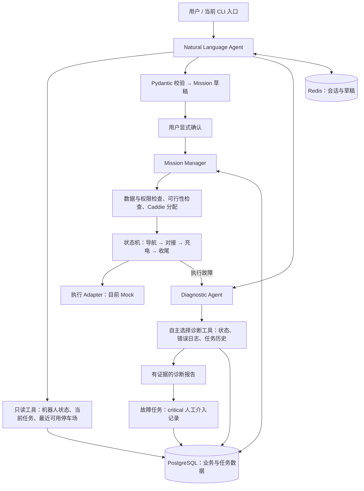
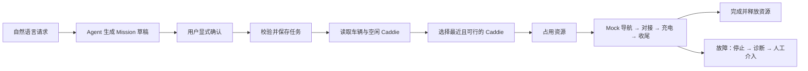
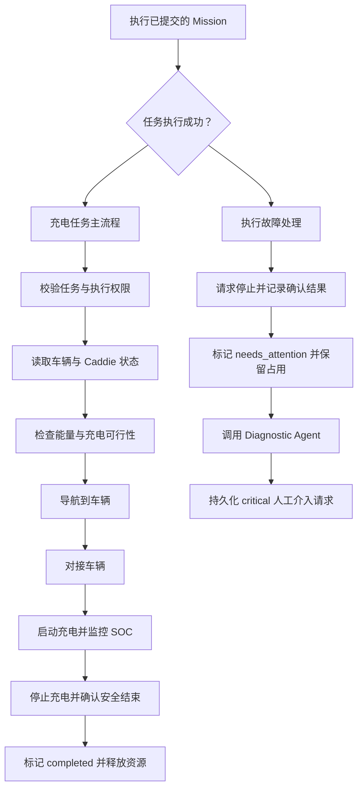
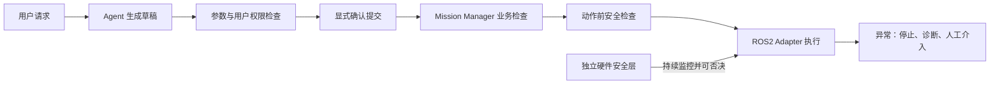

## EnerRenew Inc - AI Engineer Intern



**开发面向自主充电机器人的 AI Agent 系统，搭建自然语言理解、Structured Output、Tool Calling 与状态管理能力，实现用户自然语言指令到结构化可执行 Mission 的自动转换，`任务意图识别准确率达 96%`。**

**System Prompt:** System,User,Asistant三部分。Intent枚举意图。

`提升任务意图识别率`：

1. 明确意图边界：“哪里能充电”属于停车场查询，“给我的车充电”属于创建任务。放入有代表性的 few-shot。

| 问题 | 优化方法 | 对应案例 |
|---|---|---|
| 参数完整仍追问 | Prompt 明确：车辆 ID 和有效目标 SOC 已确定时，直接生成草稿；“不提交、不执行”无需额外确认 | 002、007、015、164、168、198、199 |
| 修正后继续追问或丢失车辆 | 程序保存待补充任务的字段；下一轮先合并已知参数，明确修正值覆盖旧值。字段完整且无冲突时结束追问 | 193–200 |
| 模型误判 SOC 范围 | 模型负责提取原值，程序统一判断是否在 **0–100，包含边界**；越界请求替换，禁止模型自行修改范围 | 009 |
| 拒绝分类不一致 | 明确直接硬件控制、未经确认执行、读取凭据等请求使用 `unsupported`，最终返回 `rejected`；拒绝后可自然引导回业务 | 128、134、160 |

1. 少量补充 Prompt 规则：强调“参数完整直接生成草稿”“明确修正无需重复确认”，避免堆砌这 18 条原句。
2. 优化 few-shot：一个展示“只准备、不执行”的直接成功；另一个展示“无效／冲突 SOC → 用户修正 → 保留车辆并生成草稿”。
3. 加强程序中的追问状态管理：保存已知字段和真正缺失、冲突的字段，让后续处理依据明确状态判断，减少依赖模型重新理解历史。
4. 调整评测中不合理的约束：125 已正确拒绝，而且用户明确提供了 Caddie ID，仅因保留该 ID 判失败过于严格。应允许保留明确提供的 ID，同时检查没有危险调用、草稿或泄露信息。修改后应保留旧评分，分别报告结果。

2. 优化工具 description。

**Structured Output:** 

**1. 意图 Agent**

```json
{
  "intent": "charge",
  "needs_clarification": false,
  "vehicle_id": "A17",
  "target_soc": 80,
  "message": null,
  "mission_id": null,
  "caddie_id": null
}
```

**2. Tool Calling**

name：工具名称
description：功能和适用场景，帮助模型选择
parameters：参数 JSON Schema，描述字段、类型和必填项

```python
"name": "ParsedIntent"

"""Submit a structured intent for charging drafts, clarification, conversation or unsupported requests.
Use charge for charging requests. Preserve explicit IDs and numeric SOC, including out-of-range values.
Missing or inapplicable parameters are null. For missing targets/parameters, ambiguity, conflicts,
SOC outside target_soc_min/max, relative SOC, multiple vehicles, scheduling or extra actions,
keep the business intent, set needs_clarification=true and ask a question in message; do not call a read tool.
Use unknown with needs_clarification=true and a question when no single business intent is identifiable,
including mixed business requests. Use unsupported for unavailable robot operations, hardware/ROS
commands or safety bypass. For small talk, off-topic or unintelligible input, use conversation with
a brief message and an invitation to charging or status/parking queries; business parameters=null
and needs_clarification=false. Ready business requests use needs_clarification=false and message=null;
the program generates result messages. Use read tools for complete queries and diagnostics when available.
"""

intent: Intent
needs_clarification: bool = False
vehicle_id: Optional[Identifier] = None
target_soc: Optional[FiniteNumber] = None
message: Optional[Identifier] = None
mission_id: Optional[UUIDString] = None
caddie_id: Optional[Identifier] = None
Intent = Literal[
    "charge",
    "get_robot_status",
    "get_current_mission",
    "find_nearest_available_parking_lot",
    "unknown",
    "unsupported",
    "conversation",
    "diagnose_robot",
]
```

**3. 状态管理**

| 部分 | 保存的状态 | 如何管理 |
|---|---|---|
| **Redis** | 待追问上下文、原始诊断问题、最近的任务草稿 | 同一 `session_id` 可在重启后恢复；原子版本校验防止并发覆盖；默认不过期 |
| **PostgreSQL** | 车辆、Caddie、停车场、Mission、事件日志、检查点、人工介入记录 | 数据库事务、锁和唯一索引保证任务及资源占用一致 |
| **Mission Manager** | 任务所处阶段及执行结果 | 按确定性流程推进，持续写入 PostgreSQL |

**构建自然语言驱动的 Mission Planning 与端到端执行链路，基于 Pydantic 设计标准化 Mission Schema，并通过 Mission Manager、Behavior Tree 与 ROS2 Adapter 打通任务规划、车辆定位、导航及自主充电流程，`端到端任务成功率达 90%+`**

**Mission Planning/Mission Manager**



1. 任务接收与校验
草稿包含唯一 mission_id、vehicle_id、target_soc 和 draft 状态。显式提交后，通过 Pydantic 和权限检查，写入 PostgreSQL；相同 ID、相同参数重复提交不会创建新任务。

2. Caddie 分配
读取车辆位置和 SOC，筛选位置、电量已知的空闲 Caddie，按距离排序。逐台检查充电能量、行驶能耗、保留电量及充电能力，选择最近且通过检查的车辆，并在数据库事务中占用资源。

3. 按顺序执行
状态依次变化：
queued → checking → navigating → docking → charging → finishing → completed。
每个动作前检查权限和安全条件，并处理超时、取消及返回结果。如果车辆已达到目标 SOC，直接完成，无需机器人动作。

4. 故障处理
已分配 Caddie 的执行故障会尝试停止，进入 needs_attention，保留车辆和 Caddie 占用，再调用 Diagnostic Agent，创建 critical 级待人工处理记录。

5. 持久化与恢复
PostgreSQL 保存任务、状态变化、执行日志和检查点。重启后支持显式恢复；无法确认之前动作结果时，转人工处理，避免盲目重放动作。

**Behavior Tree（行为树）**



**开发 ROS2 智能诊断与 Agent Safety Guard，融合 Nav2、Docking、Battery、Charger、Localization 等机器人子系统状态，实现运行异常检测与自动故障定位，相比人工排查将`平均故障定位耗时降低 80%+`**

```text
用户询问故障／Mission Manager 捕获执行故障
    ↓
确定 mission_id 或 caddie_id，并校验对象
    ↓
Diagnostic Agent 根据问题、错误上下文选择工具
    ↓
读取证据
├─ PostgreSQL：最近错误、任务执行历史
└─ 状态 Adapter：导航、对接、充电状态（目前是 Mock）
    ↓
模型根据结果决定是否继续查询
    ↓
输出事实、原因假设、排查建议和缺失数据
```

**1. Agent Safety Guard**

本质上是程序执行的确定性检查，可以用 if/else、Pydantic 校验、权限规则和数据库约束实现。



| 环节 | 具体实现 |
|---|---|
| **身份与权限** | API 验证用户身份，程序检查用户是否有权操作该车辆、任务及停车场。身份来自登录凭证，不能相信模型输出的 `user_id` |
| **参数校验** | 保留 Pydantic，检查 Mission 字段和范围；车辆是否存在、数据是否齐全由数据库及状态接口验证 |
| **提交确认** | 将确认绑定到具体草稿 ID 和参数，避免确认后任务内容发生变化 |
| **业务检查** | PostgreSQL 事务检查车辆与 Caddie 占用，真实电池和充电能力数据用于可行性判断 |
| **动作前检查** | 将当前始终返回 `True` 的 `safety_check` 替换为真实检查：急停、故障、定位及设备状态是否满足当前动作要求 |
| **执行中监控** | 机器人侧持续监控安全状态。例如充电途中出现过温或连接异常，由独立安全系统立即保护设备 |
| **故障处理** | Adapter 请求停止并确认结果，Manager 保留占用、记录证据、调用诊断并创建人工介入请求 |

**Agent 评估**

测试集：
```json
    {
      "id": "intent-069",
      "input": "Any active missons rn?",
      "expected_intent": "get_current_mission",
      "expected_tool": "get_current_mission",
      "expected_parameters": {},
      "note": "Label based on the frozen current prompt and supported interfaces; synthetic case, not production data.",
      "expected_needs_clarification": false
    },
```


**未来改进**

**（1） Multi-Agent：Planner、Worker、Reviewer**

| Agent | 职责 |
|---|---|
| Planner | 根据故障现象制定调查计划，提出需要验证的假设 |
| Worker | 调用工具收集状态和日志，返回证据 |
| Reviewer | 检查结论是否有证据支持、是否存在矛盾或遗漏，必要时要求补查 |

优势是职责清晰，适合跨多个子系统、证据量大、需要多轮调查的复杂故障。代价是更多模型调用、延迟、费用和状态传递

**（2） 流量增大 Agent 如何做**

| 问题 | 用什么 | 如何解决 |
|---|---|---|
| 请求量大，单实例处理不过来 | FastAPI 多实例＋负载均衡 | 分发请求，按负载扩容；会话状态放 Redis，避免依赖单进程内存。[部署说明](https://fastapi.tiangolo.com/deployment/server-workers/) |
| 模型接口限流、响应慢 | 并发控制＋Redis 限流 | 限制每用户和整体请求量；设置超时，对限流错误有限退避重试 |
| 模型调用费用上涨 | Token 预算＋上下文裁剪 | 限制历史长度、诊断轮数和工具结果大小；按用户统计费用与配额 |
| 同一会话并发导致状态覆盖 | Redis 原子操作＋版本号 | 按用户、会话隔离状态；同一会话顺序处理，更新时检查版本 |
| 长任务阻塞聊天请求 | Redis Streams 或 RabbitMQ＋独立 Worker | 提交后返回任务 ID，后台执行；配置确认、失败处理和积压上限。[Streams 说明](https://redis.io/docs/latest/develop/data-types/streams/) |
| 重试或消息重复导致重复任务 | 幂等键＋PostgreSQL 唯一约束 | 同一次提交返回原任务；Worker 重复收到消息也不能重复执行 |
| 多个 Worker 抢同一 Caddie | PostgreSQL 事务、行锁＋资源约束 | 原子完成检查与占用；执行节点同时校验任务归属，防止旧 Worker 继续执行。[锁机制](https://www.postgresql.org/docs/17/explicit-locking.html) |
| 数据库连接耗尽、查询变慢 | 连接池＋索引＋分页 | 限制连接总量，优化车辆、任务和日志查询；短事务，避免等待模型时持锁 |
| 实例崩溃，任务无法继续 | PostgreSQL 检查点＋Worker 心跳 | 找出中断任务，核对设备结果；无法确认则转人工，不能直接重放动作 |
| 多用户数据泄露或越权 | 身份认证＋工具权限过滤 | 每次查询和操作检查用户、车辆及任务归属；权限由程序判断 |
| 用户不知道任务进度 | WebSocket／SSE＋持久化事件 | 推送真实状态；断线后按事件序号补查，恢复当前任务进度 |
| 故障和性能问题难以定位 | OpenTelemetry＋指标、日志、告警 | 串联请求、模型调用、工具和 Mission；监控延迟、失败率、费用及队列积压 |
| 用户请求超过机器人容量 | 有界队列＋准入规则 | 明确显示排队或拒绝结果，避免无限接单；多机器人调度需另行设计 |

**(3) 补充表格**

| 优先级 | 功能 | 对应用户场景 | 应该如何做 |
|---|---|---|---|
| 高 | **可靠的多轮补充与修改** | “改成 75%”“不是这辆，是 EV-002” | Redis 按会话保存已知参数、缺失字段和冲突字段；程序合并本轮修改，保留未修改参数，校验完整后生成草稿 |
| 高 | **明确的任务确认与防重复** | 用户重复发送或网络重试 | 确认绑定草稿 ID、版本和具体参数；PostgreSQL 使用幂等键和唯一约束，重复提交返回原任务 |
| 高 | **用户身份与数据权限** | 只允许操作自己的车辆和任务 | API 验证身份，将可信用户信息传给工具；每次查询和写入检查数据归属，不能依赖模型判断权限 |
| 高 | **任务全生命周期操作** | 查询进度、取消任务、修改草稿 | 增加受控任务工具，通过 Mission Manager 操作；草稿允许修改，执行中任务按状态限制修改，取消需确认停止结果 |
| 高 | **人工接管流程** | 故障后等待工作人员处理 | 提供人工处理入口，展示日志、诊断和停止状态；授权人员记录处置结果，经核验后解除占用，保留审计记录 |
| 中 | **工具失败后的可理解反馈** | 超时、无数据、权限不足、业务拒绝 | 工具统一返回错误码、是否可重试和必要上下文；程序生成针对性提示，读取操作可有限重试，写操作须保证幂等 |
| 中 | **异步进度反馈** | 用户等待导航或充电 | Mission 状态变化产生事件，通过 WebSocket／SSE 推送给用户；断线后查询持久化状态，不让模型猜测进度 |
| 中 | **诊断质量控制** | 原因不明确或证据矛盾 | 报告区分事实、假设和缺失数据；程序校验证据归属与引用，限制补查轮数，无法确认则转人工 |
| 中 | **持续评测与监控** | 发布后发现误判、延迟或费用增加 | 记录脱敏请求、工具调用、错误码和耗时；维护版本化测试集，发布前回归，线上统计关键指标并告警 |
| 中 | **能力边界与不支持请求处理** | “下午三点充电”，但系统不支持预约 | 明确声明支持的能力，检测无法满足的要求并说明限制；用户同意替代方案后再生成任务，不能悄悄忽略条件 |